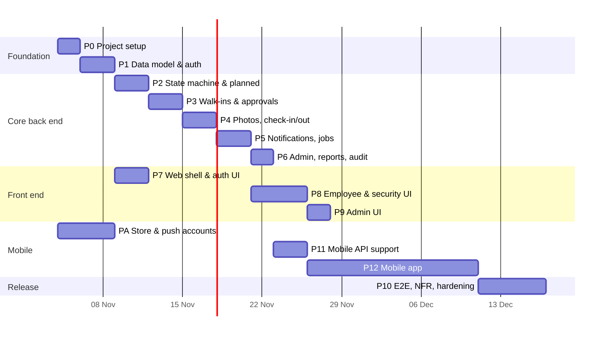

# Gatepass — Implementation Plan

| Field   | Value                                                   |
|---------|---------------------------------------------------------|
| Version | 1.2 (modular monolith, module-wise structure)           |
| Date    | 2026-11-03                                               |
| Inputs  | [requirements.md](requirements.md), [spec.md](spec.md) |
| Outputs | [tasks.md](tasks.md), [test_cases.md](test_cases.md), [testing_guide.md](testing_guide.md) |

## 1. Approach

- **Modular monolith (spec ADR-1).** One Go binary and one database; work is organised by module (spec §3.2), and each phase delivers whole modules or whole slices of a module — handler, service, repository, jobs and tests together.
- **Back end first, one vertical slice at a time.** Each phase ends with something runnable and tested end to end: API + tests, then the screens for it.
- **The state machine is the core.** It is built and unit-tested in isolation (Phase 2) before any endpoint uses it, because every flow depends on it.
- **Tests are written with the code**, not after. A task is not done until its tests in [test_cases.md](test_cases.md) pass.
- **Time is always injected** (`Clock`), so the 30-minute window, no-show and overstay rules can be tested without waiting.
- **The mobile app is a client of the same API.** No business rule lives only in the app; it uses the same `allowedActions`, the same generated client and the same validation schemas as the web.
- **Start app-store accounts in week 1.** Google Play Console, Apple Developer, Expo/EAS and Firebase (FCM) setup has lead time that does not depend on code.

## 2. Phases



Estimates assume one full-stack developer: total ≈ 10 weeks. With two developers (one on back end + web, one on mobile from P11) ≈ 6 weeks: P12 can start screens against the API contract and mocks while P8/P9 are in progress. PA is account/admin work that runs in parallel and is not developer time.

### P0 — Project setup

**Goal:** an empty but complete monorepo that builds, lints, tests and runs with one command.

- Repository layout from spec §3.4: `backend/internal/{app,modules,platform,apigen,testutil}`, empty module packages with `module.go` stubs, `frontend/src/{app,modules,shared}`, `api/openapi.yaml` + `api/modules/`, `e2e/`, `testdata/`.
- Architecture checks wired into `make lint` and CI from day one: `.go-arch-lint.yml` with the allowed dependencies in spec §3.3, `eslint-plugin-boundaries` for the web.
- `Makefile` targets: `gen` (oapi-codegen, openapi-typescript), `lint` (golangci-lint, ESLint), `test`, `test-int`, `test-e2e`, `build`, `run`, and the `db-*` / `migrate-*` targets from spec §5.5.
- Docker Compose: Postgres 16 (with `00-roles.sql` creating `gatepass_owner` and `gatepass_app`), MailHog.
- Config struct loaded from env and validated at start-up; `.env.example`.
- Go test helpers (testcontainers Postgres), Vitest for the web, Playwright skeleton.
- CI workflow: Go (gen-check → lint → vet → unit → integration with `-race` and coverage → govulncheck) and web (lint → typecheck → test → build), then binary build with embedded SPA.
- `GET /api/health`.

**Exit:** `docker compose up -d` + `make run` serves the API and a blank SPA (Vite dev server proxies to Go); CI is green.

### P1 — Data model and authentication

**Goal:** all tables exist; users can log in and out with roles enforced.

- goose migrations for every table in spec §5.2, with role grants and the append-only rule on `audit_logs` (spec §5.5).
- GORM setup per spec §5.4 (config, slog logger bridge, pool settings, `WithTx` with after-commit hooks); GORM models and repository interfaces.
- `gatepass migrate`, `gatepass seed`, `gatepass create-admin` sub-commands.
- Seed script: one Admin, two Employees, one Security user, default settings.
- `platform.Clock`, `storage.Store`, `Mailer` interfaces + implementations; transaction helper with `afterCommit` hooks.
- Domain errors and the single error-mapping function (spec §8.1); request ID, `slog` logging, panic recovery, security headers.
- `scs` sessions in Postgres, login/logout/me, lockout, change password, forgot/reset password, rate limits.
- `RequireAuth`, `RequireRole`, `PASSWORD_CHANGE_REQUIRED` middleware; CSRF header check.
- Admin user management endpoints; employee search.

**Exit:** auth and user integration tests pass (TC-AUTH-*, TC-USR-*).

### P2 — State machine and planned visits

**Goal:** employees can create, edit, cancel and list planned visits.

- OpenAPI contract for visit endpoints; regenerate Go and TS code.
- Custom validation rules in Go + `testdata/validation_vectors.json`.
- State machine (`visits/statemachine.go`): transition table, guards, `AllowedActions()` (pure functions, table-driven tests).
- `visits.Service.Transition()` with conditional update, audit write, after-commit event hook (spec §6.3).
- Visit code generator.
- Visitor upsert by mobile; `/visitors/lookup`.
- Planned visit endpoints; `GET /visits`, `GET /visits/:id` with role scoping.

**Exit:** TC-SM-*, TC-PV-* pass.

### P3 — Walk-ins and approvals

**Goal:** security registers a walk-in, host accepts/rejects inside the window.

- Walk-in endpoint with `VISITOR_ALREADY_ACTIVE` rule.
- Approve / reject / cancel endpoints with deadline guard and lazy expiry.
- Concurrency test: accept racing expiry.

**Exit:** TC-WI-* pass.

### P4 — Photos, check-in, Meeting Over, check-out

**Goal:** the full gate flow works through the API.

- Upload pipeline (`MaxBytesReader` → content sniffing → `DecodeConfig` size guard → decode/orient/resize/re-encode → storage), photo streaming with BR-10 checks.
- Check-in (date + photos + active-visitor guards), deny, Meeting Over, check-out, force-close.

**Exit:** TC-PH-*, TC-CI-*, TC-MO-*, TC-CO-* pass. The planned happy path (AC-1) passes as an API-level test.

### P5 — Notifications, real-time and jobs

**Goal:** people are told what happens, and time-based rules run on their own.

- Notification service (DB row + SSE push + optional email with retry in a background goroutine).
- SSE hub and `GET /api/events` with session auth, heartbeat and slow-client drop.
- Notification endpoints.
- Jobs with `robfig/cron`: expire, reminder, overstay, no-show, purge photos/records/tokens, advisory lock, graceful stop.
- Dashboards: `/dashboard/employee`, `/dashboard/security`.

**Exit:** TC-NT-*, TC-JOB-*, TC-DB-* pass.

### P6 — Admin, reports and audit

- Audit endpoint, settings endpoints (window change affects only new walk-ins), CSV export, CSV user import.

**Exit:** TC-AUD-*, TC-RPT-*, TC-SET-* pass. **Back end feature-complete.**

### P7 — Web shell and auth UI

- Vite + React + Router + TanStack Query + Tailwind; `openapi-fetch` client from generated types, with error mapping.
- Layout, header, role-based redirect, route guards, 401 handling.
- Login, forgot/reset password, forced change password.
- Notification bell (`EventSource` + unread count).

**Exit:** TC-UI-AUTH-* pass.

### P8 — Employee and security UI

- Employee: dashboard, planned visit form (with mobile prefill), my visits, approval cards with countdown, Meeting Over.
- Security: dashboard tabs with counts and search, walk-in form with employee typeahead, check-in screen with camera capture/retake/fallback, deny, check-out.
- Visit detail page with timeline and `allowedActions`.
- Real-time refresh via `visit-updated`.

**Exit:** TC-UI-EMP-*, TC-UI-SEC-* pass.

### P9 — Admin UI

- Users (list, create, edit, activate/deactivate, reset password, import), all visits with filters and CSV export, visit audit view, settings form.

**Exit:** TC-UI-ADM-* pass.

### P10 — End-to-end, non-functional, hardening

- Playwright suites for AC-1…AC-8 (fake camera).
- k6 load test (NFR-1), real-time latency check (NFR-2), expiry accuracy (NFR-3).
- axe accessibility scan of key screens (NFR-11).
- Security review: headers, CSP, CSRF header, rate limits, `govulncheck`, `npm audit`, Go fuzz tests for the upload pipeline.
- Production build: single Go binary with embedded SPA and migrations, distroless Docker image; deployment and backup notes in `README.md`.
- User guides (one page each) for Employee, Security and Admin.

- Mobile: Maestro flows for AC-9…AC-11 on the Android emulator; manual device checklist on a physical Android phone and iPhone ([testing_guide.md](testing_guide.md) §8); push latency (NFR-12) and cold-start (NFR-13) measurements.
- Mobile release: `production` EAS builds, upload to Google Play internal testing and TestFlight, UAT testers invited.

**Exit:** release checklist (§5) complete.

### PA — Store and push accounts (non-development, starts day 1)

- Google Play Console account and app entry (package `com.<company>.gatepass`); internal testing track.
- Apple Developer Program membership; App Store Connect app entry (bundle ID); TestFlight internal testers.
- Expo account / organisation; EAS project; Expo access token for the server.
- Firebase project for FCM; upload FCM v1 service-account key and the APNs key to EAS credentials.

**Exit:** a `preview` build installs on an Android phone; a TestFlight build can be sent to an iPhone.

### P11 — Mobile API support

**Goal:** everything the app needs exists in the API and is tested before app screens are built.

- Mobile sessions (bearer token, second session manager, 7 d / 30 d), `MOBILE_NOT_ALLOWED`, CSRF skip for bearer requests.
- `device_tokens`, `push_tickets` migrations; `POST /devices`, `DELETE /devices/current`; logout/deactivation cleanup.
- `PushSender` interface, Expo implementation, fake implementation; push for catalogue types; content rules.
- `pushReceipts` and `purgeDevices` jobs.
- `/app-config`, `X-App-Version` gate (`426`).
- OpenAPI contract updated; `packages/client` regenerated.

**Exit:** TC-MAUTH-*, TC-PUSH-*, TC-APPCFG-* pass.

### P12 — Mobile app

**Goal:** employees can do everything a host does, from their phone, with push.

- Expo project in `mobile/` with the module layout from spec §3.4 (`app/` thin routes, `src/modules/*`, `src/shared/`), TypeScript strict, Expo Router, ESLint with `eslint-plugin-boundaries`, `eas.json` profiles, `app.config.ts` with `EXPO_PUBLIC_API_URL` and `gatepass` scheme.
- API layer on `packages/client` with bearer token, `X-App-Version`, server time offset, 401 → sign-in.
- Auth: sign-in, forced password change, secure token storage, logout, `MOBILE_NOT_ALLOWED` message.
- Push: permission explanation, token registration, Android channels, foreground banner, tap → deep link, cleanup on logout.
- Screens: home (approvals with countdown, today, upcoming), my visits, visit detail with photo, planned visit form, notifications, profile.
- Offline banner + persisted read-only cache; update-required screen; optional biometric lock.
- Jest + RNTL tests; Maestro flows.

**Exit:** TC-MOB-*, TC-ME2E-* pass on the Android emulator; a `preview` build works on a physical phone against the laptop API.

## 3. Dependencies and Critical Path

```
P0 → P1 → P2 → P3 → P4 → P5 → P6 → P11 → P12 ─┐
       └──→ P7 ───────────→ P8 → P9 ───────────┴→ P10
PA (accounts, parallel from day 1) ─────────────→ P10 (store uploads)
```

Critical path (one developer): **P0 → … → P6 → P11 → P12 → P10**. With two developers the web (P7–P9) and mobile (P12) tracks run in parallel after P11. The state machine (P2), photo pipeline (P4) and push delivery (P11/P12) carry the most risk.

## 4. Risks in Delivery

| Risk                                                  | Mitigation in the plan                                                                   |
|-------------------------------------------------------|------------------------------------------------------------------------------------------|
| Camera behaviour differs across browsers / tablets    | Build the capture component early in P8 with file-input fallback; test on the actual gate device before P10 |
| Race conditions around approval deadline and double clicks | Conditional updates (spec §6.3) + explicit concurrency integration tests in P3/P4     |
| Time-zone bugs at midnight (no-show, "today")         | All "today" logic through `Clock.today()`; tests at 23:59 / 00:01 IST                     |
| Email delivery problems blocking actions               | Email is fire-and-forget with retry; never in the transaction                             |
| Scope creep (QR passes, SMS, HRMS sync)               | Logged as Release 2 items; change requests go through requirements.md                     |
| Push works in development but not on real devices (credentials, battery savers, iOS permission) | Test push on a physical Android phone at the end of P11 using a `preview` build; iPhone via TestFlight as soon as PA is done |
| Apple / Google account setup or review delays          | PA starts day 1; UAT uses internal tracks (no public review); web portal is a fallback for everyone |
| Expo SDK upgrade during the project                    | Pin the SDK at project start; upgrade only between releases                               |

## 5. Definition of Done

**Per task**
- Code lives in the module that owns it (spec §3.2) and follows the module rules M-1…M-8 (spec §3.3); `make arch-lint` passes.
- No business rules in handlers, `platform/` or React components.
- Linked test cases in [test_cases.md](test_cases.md) are automated and passing (Go tests with `-race`).
- `gofmt`, `go vet`, `golangci-lint`, ESLint and `tsc` clean; no `any` in TS without a comment explaining why.
- `make gen` produces no diff (generated code committed and current).
- New env vars added to `.env.example`; new endpoints added to `api/openapi.yaml` and match spec §8.

**Release checklist**
- All Must requirements implemented; Should items implemented or explicitly deferred.
- All P1/P2 test cases pass; no open defects of severity High or above.
- Backend business-logic coverage ≥ 80%; `modules/visits` ≥ 90%.
- NFR-1, NFR-2, NFR-3 measured and recorded.
- axe scan shows no serious/critical violations on key screens.
- Mobile: Maestro suite green; device checklist passed on at least one Android phone and one iPhone; NFR-12 and NFR-13 measured.
- Mobile builds available on Google Play internal testing and TestFlight; `MOBILE_MIN_VERSION` set.
- Seed data removed from production; Admin account created with a forced password change.
- Backup of Postgres and photo volume configured.
- Stakeholder UAT sign-off (requirements §17).
