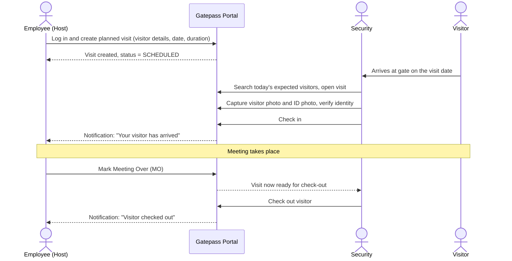
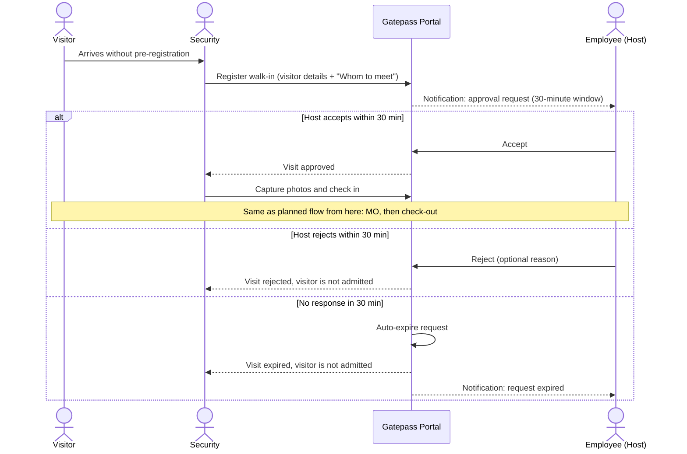
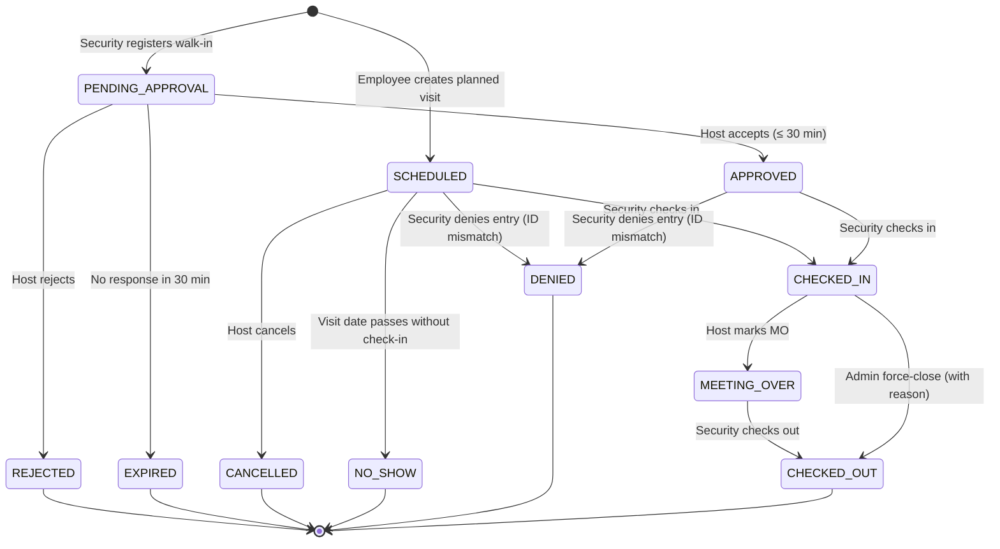

# Gatepass — Business Requirements Document (BRD)

| Field            | Value                                          |
|------------------|------------------------------------------------|
| Product          | Gatepass: Visitor Gate Pass & Security System  |
| Document type    | Business Requirements Document                 |
| Version          | 1.2 (Draft for review)                         |
| Date             | 2026-11-03                                      |
| Author           | Product / Business Analysis                    |
| Status           | Draft, pending stakeholder sign-off            |
| Next documents   | `spec.md` → `plan.md` → `tasks.md` → `test_cases.md` → `testing_guide.md` |

**Change log**

| Version | Change |
|---------|--------|
| 1.0 | Initial draft (web portal only) |
| 1.1 | Added the employee mobile app (Android + iOS) with push notifications: scope, FR-10.x, push channel in §8.7, NFR-12…15, AC-9…AC-11, assumptions, constraints, risks, Q-10…Q-12 |
| 1.2 | Added constraints 6 and 7: monolithic (modular monolith) architecture, no microservices; module-wise code structure |

---

## 1. Background

The organisation is moving its office to a new location. The new premises need a controlled, auditable way to manage visitors who come to meet employees. Today visitor entry is handled informally (paper register / verbal confirmation), which gives:

- no record of who is on the premises at a given time,
- no confirmation from the host employee before a walk-in visitor is let in,
- no photo or ID proof kept for visitors,
- no reliable check-out, so visitors may stay longer than intended without anyone knowing.

**Gatepass** is a web portal that digitises the visitor lifecycle: pre-registration by employees, verification and check-in by security, host approval for walk-ins, and check-out once the host closes the meeting.

## 2. Business Objectives

| ID   | Objective                                                                  | Success measure (target)                                       |
|------|----------------------------------------------------------------------------|----------------------------------------------------------------|
| BO-1 | Every visitor on premises is recorded digitally with photo and ID proof     | 100% of check-ins have a visitor photo and an ID photo         |
| BO-2 | No walk-in visitor enters without explicit host consent                     | 0 unplanned check-ins without an "Accepted" decision           |
| BO-3 | Security knows in real time who is inside the building                      | Live "Visitors on premises" list available to security         |
| BO-4 | Faster gate processing for expected visitors                                | Planned visitor check-in completed in ≤ 2 minutes at the gate  |
| BO-5 | Full audit trail for compliance and incident investigation                  | Every state change is logged with actor and timestamp          |
| BO-6 | Hosts can respond to walk-ins from anywhere in the office                   | ≥ 90% of walk-in requests answered within the 30-minute window  |

## 3. Scope

### 3.1 In scope (Release 1)

1. Login for Employees, Security staff and Admin.
2. **Planned visits:** employee pre-registers a visitor (name, visit date, expected duration and related details).
3. **Unplanned (walk-in) visits:** security registers the walk-in, including the host employee ("Whom to meet").
4. Host notification and **Accept / Reject within 30 minutes** for walk-ins.
5. Security check-in with **visitor photo** and **photo of a valid ID** taken through the device camera.
6. Employee marks **Meeting Over (MO)**.
7. Security **check-out**, allowed only after MO.
8. Dashboards: employee's own visits; security's today's expected, pending, on-premises and completed visits.
9. Admin management of users (employees and security staff).
10. Audit log and basic visit reports.
11. **Employee mobile app** (Android and iOS) with **push notifications**: approve/reject walk-ins, mark Meeting Over, create and manage planned visits, see own visits and notifications.

### 3.2 Out of scope (Release 1)

- Printed badges / QR-code passes and hardware integration (turnstiles, badge printers, access cards).
- Visitor self-service kiosk or visitor-facing mobile app.
- Security and Admin features in the mobile app. Security and Admin use the web portal (Admins can still use the app for visits they host).
- Offline actions in the mobile app (the app shows cached data read-only when offline).
- Actionable push notifications (Accept/Reject buttons inside the notification). Candidate for Release 2.
- SMS / WhatsApp notifications. Release 1 uses in-app, email and mobile push notifications.
- Integration with HRMS / Active Directory / SSO. Users are managed in the portal.
- Multi-site / multi-building support.
- Vehicle and material (asset) gate passes.
- Visitor blacklist / watchlist. Candidate for Release 2.

## 4. Stakeholders

| Stakeholder              | Interest                                                        |
|--------------------------|-----------------------------------------------------------------|
| Facilities / Admin team  | Business owner; owns the visitor policy and user management     |
| Security team (guards)   | Main daily users at the gate                                     |
| Employees (hosts)        | Invite visitors, approve walk-ins, close meetings               |
| Visitors                 | Indirect users; their personal data is captured                  |
| IT / Engineering         | Build, host and support the system                               |
| HR / Legal / Compliance  | Data privacy, retention of visitor photos and ID data            |

## 5. User Roles

| Role         | Description                                     | Key permissions                                                                                                      |
|--------------|-------------------------------------------------|---------------------------------------------------------------------------------------------------------------------|
| **Employee** | Any staff member who can host visitors          | Create / edit / cancel own planned visits; accept or reject walk-ins addressed to them; mark Meeting Over; view own visit history |
| **Security** | Guard stationed at the gate / reception         | View all visits; register walk-ins; capture photos; check in; check out (after MO); view who is on premises              |
| **Admin**    | Facilities / office admin                       | Manage users and roles; view all visits and reports; view audit log; force-close a visit (with reason)                   |

A visitor is **not** a system user and does not log in.

**Channels:** Employees can use the web portal **or** the mobile app. Security uses the web portal on a gate laptop/tablet. Admin uses the web portal.

## 6. Glossary

| Term                 | Meaning                                                                                       |
|----------------------|-----------------------------------------------------------------------------------------------|
| Host                 | The employee the visitor has come to meet                                                      |
| Planned visit        | A visit pre-registered by the host employee before the visitor arrives                        |
| Unplanned visit      | A walk-in: visitor arrives without pre-registration; security registers them                  |
| Check-in             | Security verifies the visitor, captures photos and lets them onto the premises                 |
| MO (Meeting Over)    | Host's confirmation that the meeting has ended and the visitor may leave                      |
| Check-out            | Security records the visitor leaving the premises                                             |
| Approval window      | The 30 minutes a host has to accept or reject an unplanned visit                              |
| Visit ID / Pass No.  | Unique human-readable reference for a visit (e.g. `GP-20261103-0042`)                          |

## 7. Business Process Flows

### 7.1 Planned visit

### 7.2 Unplanned (walk-in) visit

### 7.3 Visit status lifecycle

## 8. Functional Requirements

Priority uses MoSCoW: **M** = Must, **S** = Should, **C** = Could.

### 8.1 Authentication & access

| ID     | Requirement                                                                                                   | Priority |
|--------|---------------------------------------------------------------------------------------------------------------|----------|
| FR-1.1 | Users log in with email and password.                                                                          | M        |
| FR-1.2 | The system enforces role-based access (Employee, Security, Admin). A user sees only the screens and actions allowed for their role. | M |
| FR-1.3 | Sessions expire after a period of inactivity.                                                                  | M        |
| FR-1.4 | Users can log out.                                                                                             | M        |
| FR-1.5 | Users can reset a forgotten password.                                                                         | S        |
| FR-1.6 | Admin can create, edit, deactivate and reactivate users and assign roles. Deactivated users cannot log in and cannot be chosen as hosts. | M |

### 8.2 Planned visits (Employee)

| ID     | Requirement                                                                                                   | Priority |
|--------|---------------------------------------------------------------------------------------------------------------|----------|
| FR-2.1 | An employee can create a planned visit with: **visitor full name** (required), **visitor mobile number** (required), visitor email (optional), visitor company / organisation (optional), **purpose of visit** (required), **visit date** (required), **expected arrival time** (optional), **expected duration** (required, e.g. 30 min – 8 hrs). | M |
| FR-2.2 | The host of a planned visit is the logged-in employee who creates it.                                         | M        |
| FR-2.3 | The visit date must be today or a future date, no more than 30 days ahead (configurable).                     | M        |
| FR-2.4 | On creation the visit gets a unique Visit ID and status `SCHEDULED`.                                           | M        |
| FR-2.5 | The employee can edit a planned visit while it is `SCHEDULED`.                                                 | M        |
| FR-2.6 | The employee can cancel a planned visit while it is `SCHEDULED`. Cancelled visits cannot be checked in.        | M        |
| FR-2.7 | The visitor receives an email with visit details if an email address was given.                              | C        |
| FR-2.8 | An employee can list their own visits (upcoming, in progress, past) and filter them by status and date.        | M        |

### 8.3 Unplanned (walk-in) visits (Security)

| ID     | Requirement                                                                                                   | Priority |
|--------|---------------------------------------------------------------------------------------------------------------|----------|
| FR-3.1 | Security can register a walk-in visitor with the same visitor fields as FR-2.1 plus **"Whom to meet"** (required). The visit date is today and cannot be changed. | M |
| FR-3.2 | "Whom to meet" is chosen by searching active employees by name, email or employee ID. Free text is not allowed. | M |
| FR-3.3 | On submission the visit gets status `PENDING_APPROVAL` and the host employee is notified straight away.        | M        |
| FR-3.4 | The host can **Accept** or **Reject** the request from the portal. A rejection reason is optional.            | M        |
| FR-3.5 | The host must respond within **30 minutes** of the request being created. After 30 minutes with no response the visit becomes `EXPIRED` automatically and can no longer be accepted. | M |
| FR-3.6 | Security sees the live approval status and remaining time for each pending walk-in.                             | M        |
| FR-3.7 | Once accepted (`APPROVED`), the walk-in follows the planned visit flow (check-in → MO → check-out).            | M        |
| FR-3.8 | If rejected or expired, the visitor is not admitted. Security may register a new request (e.g. for a different host); the old record stays unchanged for audit. | M |
| FR-3.9 | Security can cancel a pending request (e.g. the visitor leaves before a decision).                             | S        |

### 8.4 Check-in (Security)

| ID     | Requirement                                                                                                   | Priority |
|--------|---------------------------------------------------------------------------------------------------------------|----------|
| FR-4.1 | Security can see today's expected visitors (`SCHEDULED` for today, plus `APPROVED` walk-ins) and search by visitor name, mobile number or Visit ID. | M |
| FR-4.2 | Before check-in, security must capture a **live photo of the visitor** using the device camera.                | M        |
| FR-4.3 | Before check-in, security must capture a **photo of a valid government-issued ID** and record the **ID type** (e.g. Aadhaar, PAN, Passport, Driving Licence, Voter ID) and optionally the last 4 digits of the ID number. | M |
| FR-4.4 | Check-in is only allowed when status is `SCHEDULED` (and the visit date is today) or `APPROVED`.               | M        |
| FR-4.5 | On check-in the system records the check-in time and the security user, sets status to `CHECKED_IN`, and notifies the host. | M |
| FR-4.6 | Security can retake a photo before confirming check-in.                                                       | S        |
| FR-4.7 | If the visitor's details do not match the visit (e.g. a different name on the ID), security can deny entry with a reason; the visit becomes `DENIED`. | S |

### 8.5 Meeting Over (Employee)

| ID     | Requirement                                                                                                   | Priority |
|--------|---------------------------------------------------------------------------------------------------------------|----------|
| FR-5.1 | The host can mark a `CHECKED_IN` visit as **Meeting Over**. Status changes to `MEETING_OVER` and the time is recorded. | M |
| FR-5.2 | Only the host of the visit can mark MO (Admin can force-close, see FR-6.4).                                    | M        |
| FR-5.3 | Security is notified / sees on the dashboard that the visitor is ready for check-out.                          | M        |
| FR-5.4 | If a visitor is still `CHECKED_IN` past their expected duration, the host gets a reminder to mark MO, and security sees the visit flagged as **Overstay**. | S |

### 8.6 Check-out (Security)

| ID     | Requirement                                                                                                   | Priority |
|--------|---------------------------------------------------------------------------------------------------------------|----------|
| FR-6.1 | Security can check out a visitor **only when status is `MEETING_OVER`**. The check-out action is disabled for any other status. | M |
| FR-6.2 | On check-out the system records check-out time and security user, and sets status to `CHECKED_OUT`. The host is notified. | M |
| FR-6.3 | Security has a live list of **visitors currently on premises** (`CHECKED_IN` + `MEETING_OVER`).                 | M        |
| FR-6.4 | Admin can force-close a visit (e.g. host is unreachable or forgot to mark MO, or visitor left without checking out) by giving a mandatory reason. This is recorded in the audit log. | M |

### 8.7 Notifications

| ID     | Event                                           | Recipient          | Channel          | Priority |
|--------|-------------------------------------------------|--------------------|------------------|----------|
| FR-7.1 | Walk-in approval request created                | Host               | In-app + email + push | M   |
| FR-7.2 | Approval request about to expire (e.g. 10 min left) | Host           | In-app + push    | S        |
| FR-7.3 | Approval request accepted / rejected / expired  | Security (gate)    | In-app (live)    | M        |
| FR-7.4 | Visitor checked in                              | Host               | In-app + email + push | M   |
| FR-7.5 | Visit overstayed expected duration              | Host, Security     | In-app (+ push to host) | S |
| FR-7.6 | Meeting marked over                             | Security           | In-app (live)    | M        |
| FR-7.7 | Visitor checked out                             | Host               | In-app           | S        |
| FR-7.8 | Approval request expired without response       | Host               | In-app + push    | M        |

In-app notifications appear without a page refresh and show an unread count. Push notifications go to every phone where the host is logged in to the mobile app. A host who has not installed the app still gets in-app and email notifications, so the app is not mandatory.

### 8.8 Dashboards, search & reports

| ID     | Requirement                                                                                                   | Priority |
|--------|---------------------------------------------------------------------------------------------------------------|----------|
| FR-8.1 | **Employee dashboard:** pending approval requests (with countdown), today's visitors, upcoming visits, visits waiting for MO. | M |
| FR-8.2 | **Security dashboard:** expected today, pending approvals, on premises, ready for check-out, overstays.         | M        |
| FR-8.3 | **Admin:** view and filter all visits by date range, status, host and visit type.                              | M        |
| FR-8.4 | Export the visit report (filtered) to CSV.                                                                     | S        |
| FR-8.5 | Visit detail page shows all fields, photos (to authorised roles), and a status timeline.                       | M        |

### 8.9 Audit

| ID     | Requirement                                                                                                   | Priority |
|--------|---------------------------------------------------------------------------------------------------------------|----------|
| FR-9.1 | Every status change and every create / edit / cancel / force-close records actor, role, timestamp, old → new status and reason (if any). | M |
| FR-9.2 | Audit entries cannot be edited or deleted through the application.                                            | M        |
| FR-9.3 | Admin can view the audit log for any visit.                                                                    | M        |

### 8.10 Employee mobile app

| ID      | Requirement                                                                                                                         | Priority |
|---------|-------------------------------------------------------------------------------------------------------------------------------------|----------|
| FR-10.1 | The app runs on Android and iOS and is available to all Employees (and Admins acting as hosts). Security users cannot sign in to the app; they see a message to use the web portal. | M |
| FR-10.2 | Employees sign in with the same email and password as the web portal; forced password change on first login applies.                 | M        |
| FR-10.3 | The app stays signed in between uses (see NFR-15) and the session is stored securely on the device. Logging out on the phone stops push notifications to that phone. | M |
| FR-10.4 | Home screen shows pending approval requests (with live countdown), today's visitors, visits waiting for Meeting Over, and upcoming visits. | M |
| FR-10.5 | The employee can Accept or Reject a walk-in (reason optional) and mark Meeting Over from the app, with the same rules as the web portal. | M |
| FR-10.6 | The employee can create, edit and cancel planned visits and list their own visits.                                                 | M        |
| FR-10.7 | The employee can view visit details, including the visitor photo once captured (never the ID photo).                                | S        |
| FR-10.8 | The app receives push notifications for the host events in §8.7. Tapping a notification opens the related visit.                   | M        |
| FR-10.9 | The app asks for notification permission after first sign-in, explains why, and shows a warning on the home screen if permission is denied. | M  |
| FR-10.10 | The app shows a notification list with unread count and mark-as-read.                                                              | S        |
| FR-10.11 | When offline, the app shows an offline banner, keeps the last loaded data visible read-only, and disables actions.                | S        |
| FR-10.12 | If the installed app version is no longer supported, the app shows an "Update required" screen instead of the normal screens.      | S        |
| FR-10.13 | The app can be locked with the phone's biometrics or passcode when reopened after 5 minutes in the background.                    | C        |

## 9. Business Rules

| ID    | Rule                                                                                                                         |
|-------|------------------------------------------------------------------------------------------------------------------------------|
| BR-1  | Nobody is checked in without a visitor photo **and** an ID photo.                                                             |
| BR-2  | A walk-in is checked in only after the host **accepts**. Security cannot override a rejection or an expiry.                    |
| BR-3  | The approval window is **30 minutes** from the moment the request is created. Responses after that are not accepted. (The value is configurable by Admin; default 30.) |
| BR-4  | Check-out is allowed only after the host marks **Meeting Over**. The only exception is Admin force-close with a reason.       |
| BR-5  | A planned visit can be checked in only on its scheduled date.                                                                 |
| BR-6  | `SCHEDULED` visits not checked in by end of the visit date (23:59 local time) become `NO_SHOW` automatically.                  |
| BR-7  | One visit record = one visitor. Group visits are entered as separate visits (see open question Q-4).                         |
| BR-8  | Final statuses (`CHECKED_OUT`, `REJECTED`, `EXPIRED`, `CANCELLED`, `NO_SHOW`, `DENIED`) cannot be changed.                              |
| BR-9  | Employees can only see and act on visits where they are the host.                                                             |
| BR-10 | Visitor photos and ID images can be viewed only by Security and Admin, and by the host for the visitor photo only.            |
| BR-11 | All times are stored in UTC and shown in the office's local time zone (IST).                                                  |

## 10. Data Requirements

### 10.1 Key entities

| Entity            | Key attributes                                                                                                     |
|-------------------|--------------------------------------------------------------------------------------------------------------------|
| User              | Name, email, employee ID, department, phone, role, active flag                                                     |
| Visitor           | Full name, mobile, email, company                                                                                  |
| Visit             | Visit ID, type (planned/unplanned), visitor, host, purpose, visit date, expected arrival, expected duration, status, created by, approval deadline, decision time, rejection reason, check-in time/by, MO time, check-out time/by, force-close reason |
| Visit Photo       | Visit, kind (visitor / ID), file reference, captured by, captured at, ID type, ID last 4 digits                     |
| Notification      | Recipient, type, visit, message, read flag, created at                                                             |
| Audit Log         | Visit, actor, action, from-status, to-status, reason, timestamp                                                    |

### 10.2 Retention and privacy

- Visitor photos and ID images are personal data. They are kept for **90 days** after check-out (configurable), then deleted automatically. Visit metadata is kept for **1 year**. *Final values to be confirmed by Legal (Q-6).*
- The full ID number is **not** stored; only ID type, the image and optionally the last 4 digits.
- Processing must follow applicable data protection law (e.g. India's Digital Personal Data Protection Act, 2023), including a visible notice to visitors at the gate that their photo and ID are being captured.

## 11. Non-Functional Requirements

| ID     | Category        | Requirement                                                                                           |
|--------|-----------------|-------------------------------------------------------------------------------------------------------|
| NFR-1  | Performance     | Normal pages and API calls respond within 2 s (95th percentile) for up to 100 concurrent users.        |
| NFR-2  | Real-time       | Approval decisions and MO updates appear on the security dashboard within 5 seconds.                  |
| NFR-3  | Timing accuracy | Auto-expiry of approval requests happens within 1 minute of the 30-minute deadline.                    |
| NFR-4  | Availability    | 99.5% during office hours (08:00–21:00 IST, Mon–Sat).                                                  |
| NFR-5  | Security        | HTTPS only; passwords stored hashed; role checks enforced on the server; photos served only to authorised users; protection against OWASP Top 10. |
| NFR-6  | Usability       | Security screens work on a tablet / laptop with a webcam; main gate actions need no more than 3 clicks from the dashboard. |
| NFR-7  | Compatibility   | Web: latest two versions of Chrome, Edge and Firefox on desktop and tablet. Mobile app: Android 10+ and iOS 16+. |
| NFR-8  | Image handling  | Photos are compressed to ≤ 500 KB each; only JPEG/PNG accepted.                                         |
| NFR-9  | Auditability    | All state changes are logged (see FR-9).                                                               |
| NFR-10 | Maintainability | Automated unit, integration and end-to-end tests for core flows; code coverage target ≥ 80% on backend business logic. |
| NFR-11 | Accessibility   | WCAG 2.1 AA for key web screens; mobile app supports screen readers (TalkBack/VoiceOver labels) and system font scaling. |
| NFR-12 | Push latency    | Push notification delivered to the phone within 10 s of the event (p95, phone online, best effort as it depends on Apple/Google services). |
| NFR-13 | App performance | Mobile app opens to the home screen within 3 s on a mid-range phone; actions respond within 2 s.         |
| NFR-14 | App security    | Session token stored only in the OS secure storage (Keychain / Keystore); no visitor photos saved to the phone's gallery or files; HTTPS only. |
| NFR-15 | App session     | Mobile session expires after 7 days without use and after 30 days at most; the user then signs in again. |

## 12. Acceptance Criteria (key scenarios)

**AC-1 Planned visit, happy path**
Given an employee has created a planned visit for today,
when security captures both photos and checks the visitor in, the host marks MO, and security checks the visitor out,
then the visit ends as `CHECKED_OUT` with check-in, MO and check-out times recorded, and each step appears in the audit log.

**AC-2 Walk-in accepted**
Given security registers a walk-in for employee X,
when X accepts within 30 minutes,
then security sees `APPROVED` within 5 seconds and can check the visitor in.

**AC-3 Walk-in rejected**
Given a pending walk-in, when the host rejects it, then the visit becomes `REJECTED` and the check-in action is not available.

**AC-4 Walk-in expired**
Given a pending walk-in, when 30 minutes pass with no response, then the visit becomes `EXPIRED`, the host can no longer accept it, and security is notified.

**AC-5 Check-out blocked before MO**
Given a visitor is `CHECKED_IN`, when security tries to check them out, then the system blocks it with the message "Waiting for host to mark Meeting Over".

**AC-6 Check-in blocked without photos**
Given a visit ready for check-in, when either the visitor photo or the ID photo is missing, then check-in is not allowed.

**AC-7 Access control**
Given employee A, when A tries to view or act on a visit hosted by employee B, then access is denied.

**AC-8 Wrong date**
Given a planned visit scheduled for tomorrow, when security tries to check the visitor in today, then check-in is blocked.

**AC-9 Walk-in approved from the phone**
Given employee X is signed in to the mobile app with notifications allowed,
when security registers a walk-in for X, then X's phone shows a push notification within 10 s; tapping it opens the request; when X accepts, security's web dashboard shows `APPROVED` within 5 s.

**AC-10 Meeting Over from the phone**
Given X's visitor is checked in, when X marks Meeting Over in the app, then security sees the visitor under "Ready for check-out".

**AC-11 Logout stops push**
Given X logs out of the app on a phone, when a new walk-in is registered for X, then that phone receives no push notification (X still gets in-app and email notifications).

## 13. Assumptions

1. Security staff use a laptop or tablet with a working camera and a stable internet connection at the gate.
2. All employees have a company email address and can reach the portal from their workstation or phone browser.
3. There is a single gate / reception at the new office for Release 1.
4. Employees are loaded once by Admin (manual entry or CSV import); no live HRMS sync.
5. Notifications are in-app and email; an SMTP service is available.
6. The office runs on one time zone (IST).
7. Most employees have a smartphone running Android 10+ or iOS 16+. Employees without one use the web portal and email.
8. The company has (or will create) a Google Play Console account and an Apple Developer account for internal app distribution.
9. Office Wi-Fi / mobile data allows phones to reach the Gatepass server over HTTPS.

## 14. Constraints

1. Release 1 must be live before the office move date (date to be confirmed by Facilities).
2. Security and Admin functions run in standard web browsers. The employee mobile app is built with a cross-platform framework (one codebase for Android and iOS).
3. Personal data (photos, ID images) must be stored on infrastructure approved by IT, not on third-party public storage without encryption.
4. Push notifications pass through Apple (APNs) and Google (FCM) services; their content must not include mobile numbers, ID details or photos.
5. iOS builds need an Apple Developer account; App Store / TestFlight review adds lead time before go-live.
6. **Architecture: monolithic.** The back end is one application with one database, deployed as a single unit (a *modular monolith*). Microservices are not used.
7. **Code structure: module-wise.** Back end, web and mobile code are organised by business module (e.g. visits, users, notifications), each module owning its code, data and tests, with dependency rules checked automatically.

## 15. Risks

| Risk                                                                     | Impact | Mitigation                                                                                 |
|--------------------------------------------------------------------------|--------|--------------------------------------------------------------------------------------------|
| Host is in a meeting and misses the 30-min approval window               | Medium | Email + in-app alert, reminder at 10 min left; security can raise a new request             |
| Host forgets to mark MO, visitor stuck at gate                            | High   | Overstay reminders; Admin force-close with reason                                           |
| Camera / network failure at the gate                                      | High   | Manual fallback register (paper) process; entries back-filled by Admin (process, not system) |
| Privacy complaint about ID images                                         | High   | Minimal data, retention policy, access restriction, visitor notice                          |
| Low adoption by employees for pre-registration                            | Medium | Simple form (< 1 minute), communication from Facilities before go-live                      |
| Push notifications blocked or delayed (permission denied, Do Not Disturb, battery saver) | Medium | Email + in-app still sent; reminder at 10 min left; in-app warning when permission is off |
| App store / distribution delays (Apple review, account setup)            | Medium | Start account setup in week 1; use TestFlight / Play internal testing for UAT; web portal works for everyone meanwhile |

## 16. Open Questions (need business decision)

| ID   | Question                                                                                                            | Proposed default (used until answered)          |
|------|---------------------------------------------------------------------------------------------------------------------|-------------------------------------------------|
| Q-1  | If the host does not respond within 30 minutes, should the visit auto-reject, or escalate to the host's manager / Admin? | Auto-expire, no escalation                      |
| Q-2  | If a host is unavailable after check-in (e.g. leaves early), who can mark MO? A delegate, or only Admin?             | Admin force-close only                          |
| Q-3  | Can a planned visit span several days (e.g. auditors visiting for a week)?                                          | No; one visit per day                            |
| Q-4  | Should one planned visit cover a group of visitors?                                                                 | No; one visitor per visit                        |
| Q-5  | Should a frequent visitor's details (and photo) be reused on future visits?                                         | Reuse name/contact by mobile number; recapture photos every visit |
| Q-6  | Exact retention periods for photos and visit records?                                                               | 90 days photos / 1 year records                 |
| Q-7  | Should security be able to check out a visitor who is physically leaving before MO (e.g. emergency)?                 | Not allowed; Admin force-close                    |
| Q-8  | Is SMS/WhatsApp to visitors or hosts needed in Release 1?                                                           | No                                               |
| Q-9  | Should the visitor get a printed / digital pass (QR) for re-entry within the same visit?                             | Out of scope for R1                               |
| Q-10 | How is the app distributed: public stores, private/managed distribution (MDM, Apple Business Manager), or internal test tracks? | Google Play internal testing + Apple TestFlight for R1 |
| Q-11 | Will employees use company-managed phones or their own phones?                                                     | Own phones (no MDM)                              |
| Q-12 | Is the 7-day idle / 30-day maximum mobile session acceptable to IT Security?                                        | Yes, with optional biometric lock (FR-10.13)     |

## 17. Sign-off

| Name | Role                    | Decision | Date |
|------|-------------------------|----------|------|
|      | Business Owner (Facilities) |      |      |
|      | Security Lead           |          |      |
|      | IT / Engineering Lead   |          |      |
|      | Legal / Compliance      |          |      |
