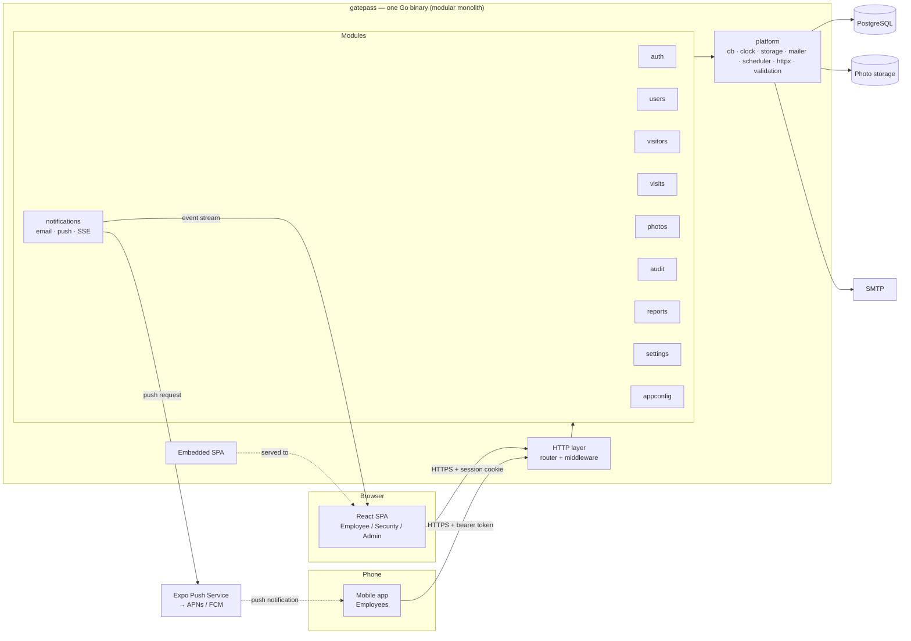
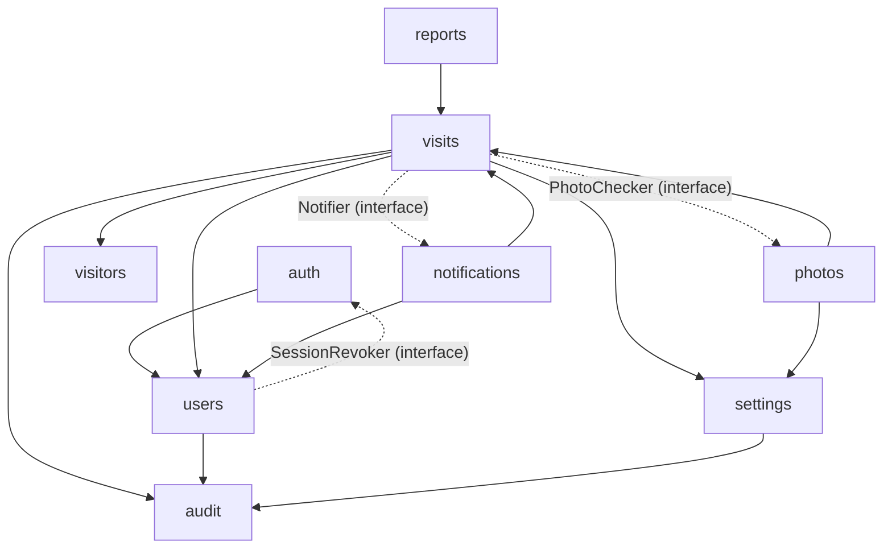
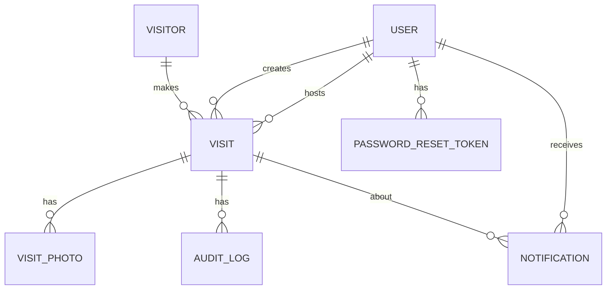

# Gatepass — Technical Specification

| Field          | Value                                                       |
|----------------|-------------------------------------------------------------|
| Version        | 1.2 (modular monolith, module-wise structure)               |
| Date           | 2026-11-03                                                   |
| Source         | [requirements.md](requirements.md) v1.1 (defaults in §16 accepted) |
| Next documents | [plan.md](plan.md) → [tasks.md](tasks.md) → [test_cases.md](test_cases.md) → [testing_guide.md](testing_guide.md) |

This document turns the business requirements into a buildable design: architecture, data model, state machine, API contracts, UI screens, background jobs and the constraints each part must respect. Requirement IDs (`FR-x.y`, `BR-n`, `NFR-n`) refer to [requirements.md](requirements.md).

---

## 1. Decisions taken from the open questions

| Q    | Decision for Release 1                                                                          |
|------|-------------------------------------------------------------------------------------------------|
| Q-1  | Unanswered walk-in requests become `EXPIRED` after the approval window. No escalation.           |
| Q-2  | Only the host marks Meeting Over. If the host is unavailable, Admin force-closes with a reason.  |
| Q-3  | One visit = one calendar day.                                                                     |
| Q-4  | One visit = one visitor. Groups are entered as separate visits.                                  |
| Q-5  | Visitor name / email / company are reused by mobile number. Photos are captured on every visit. |
| Q-6  | Photos are purged 90 days after the visit reaches a final status. Visit records are kept 1 year. |
| Q-7  | Security cannot check out before Meeting Over. Admin force-close is the only exception.          |
| Q-8  | Notifications: in-app (real-time) and email only.                                                 |
| Q-9  | No printed or QR passes.                                                                          |
| Q-10 | App distributed through Google Play internal testing and Apple TestFlight for R1.                |
| Q-11 | Employees use their own phones; no MDM.                                                            |
| Q-12 | Mobile session: 7 days idle, 30 days absolute; optional biometric lock.                            |

## 2. Technology Stack

| Layer            | Choice                                                                                  | Why                                                              |
|------------------|-----------------------------------------------------------------------------------------|------------------------------------------------------------------|
| Back-end language| **Go 1.25+**                                                                             | Single static binary, strong concurrency, fast, simple to deploy  |
| HTTP router      | `go-chi/chi/v5` + standard `net/http`                                                     | Idiomatic, middleware-friendly, no framework lock-in             |
| API contract     | **OpenAPI 3.1** is the source of truth: root `api/openapi.yaml` + one file per module in `api/modules/`, bundled by `@redocly/cli` in `make gen`; `oapi-codegen` generates Go request/response types and a strict chi server interface; `openapi-typescript` + `openapi-fetch` generate the front-end client | Front end and back end cannot drift; CI fails if generated code is stale |
| Validation       | Server: `go-playground/validator/v10` + custom rules (mobile, name, date window). Client: Zod schemas mirroring the same rules. Both run the shared test vectors in `testdata/validation_vectors.json` | Server is the authority; shared vectors keep both sides consistent |
| Database         | PostgreSQL 16                                                                            | Transactions, row-level conditional updates, `DATE`/`TIMESTAMPTZ` |
| DB access        | **GORM** (`gorm.io/gorm` + `gorm.io/driver/postgres`, pgx underneath), used under the rules in §5.4 | Familiar ORM, less boilerplate; rules keep it race-safe and testable |
| Migrations       | `pressly/goose` (SQL migrations, embedded in the binary). GORM `AutoMigrate` is not used. | Versioned, reviewable, supports grants/partial indexes/enums      |
| Sessions         | `alexedwards/scs/v2` with `postgresstore` (sessions in Postgres, via GORM's `*sql.DB`)    | Idle timeout + absolute lifetime, server-side revocation          |
| Passwords        | `golang.org/x/crypto/bcrypt`                                                              | Standard                                                         |
| Real-time        | **Server-Sent Events** (`GET /api/events`, `text/event-stream`), in-process hub           | Only server → client push is needed; works with the session cookie; browser `EventSource` reconnects automatically |
| Jobs             | `robfig/cron/v3` inside the API process, each run guarded by a Postgres advisory lock     | Expiry, reminders, no-show, retention (NFR-3)                    |
| Images           | Standard `image/jpeg`, `image/png` + `disintegration/imaging` (pure Go, no cgo)           | Auto-orient, resize, re-encode; re-encoding drops all EXIF/GPS    |
| File storage     | Local disk volume behind a `storage.Store` interface                                      | Simple for R1; S3-compatible storage can be added later           |
| Email            | `wneessen/go-mail` (SMTP); MailHog in development                                         | FR-7.x                                                            |
| Logging          | Standard `log/slog` (JSON handler)                                                        | Structured logs, no extra dependency                             |
| Config           | `caarlos0/env/v11` (env → struct, validated at start-up)                                   | Fail fast on missing config                                       |
| Rate limiting    | `go-chi/httprate`                                                                         | Per-IP and per-user limits                                        |
| Web front end    | **React 19 + TypeScript (strict) + Vite**, React Router, TanStack Query, Tailwind CSS      | Standard SPA stack; built assets are embedded in the Go binary   |
| Camera           | Browser `getUserMedia` API, with file-input fallback                                       | FR-4.2, FR-4.3                                                   |
| Testing (Go)     | `testing` + `testify`, `net/http/httptest`, `testcontainers-go` (Postgres), `-race` flag   | NFR-10; race detector catches concurrency bugs                    |
| Mobile app       | **React Native + Expo** (managed workflow, SDK version pinned at project start), TypeScript strict, Expo Router, TanStack Query (persisted cache for offline read-only), react-hook-form | One codebase for Android and iOS; shares TS client and validation with the web |
| Mobile platform libs | `expo-notifications` (push), `expo-secure-store` (session token), `expo-image` (authenticated photo), `@react-native-community/netinfo` (offline), `expo-local-authentication` (optional lock) | FR-10.x, NFR-14 |
| Push delivery    | **Expo Push Service** (forwards to Apple APNs and Google FCM), called from Go over HTTPS   | One API for both platforms; no FCM/APNs code in the backend      |
| Mobile build     | **EAS Build** profiles `development`, `preview` (internal APK / ad-hoc), `production` (Play internal track, TestFlight) | Cloud builds work from Linux, including iOS builds |
| Shared TS package| `packages/client`: generated API types + `openapi-fetch` client + Zod validation schemas, used by web and mobile | No duplication between web and app |
| Testing (web)    | Vitest + React Testing Library + MSW                                                       | Component tests                                                  |
| Testing (mobile) | Jest (`jest-expo`) + React Native Testing Library + MSW; **Maestro** for E2E on Android emulator | Component tests and scripted device flows                  |
| E2E / load       | Playwright (TypeScript), k6                                                                | AC-1…AC-8, NFR-1                                                  |
| Architecture checks | `go-arch-lint` (Go module dependencies), `eslint-plugin-boundaries` (web and mobile modules) | Keeps the monolith modular (§3.3)                              |
| Tooling          | `Makefile`, `golangci-lint`, `gofmt`, ESLint + Prettier (web), Docker Compose              | One command per task                                             |

## 3. Architecture

### 3.0 Architecture decision — modular monolith (ADR-1)

| Item          | Decision                                                                                                   |
|---------------|------------------------------------------------------------------------------------------------------------|
| Decision      | Gatepass is built as a **modular monolith**: one Go application, one deployable binary, one PostgreSQL database. **No microservices.** |
| Inside        | The code is split into **business modules** (§3.2) with explicit public contracts, one owner per table, and dependency rules checked in CI (§3.3). |
| Why           | One team, ~100 users, one site. The core flows (check-in → audit → notification) need to be atomic, which one database transaction gives for free. A single binary is simple to run, test, debug and deploy. Microservices would add network calls, distributed transactions, service discovery and several deployments with no benefit at this scale. |
| Future option | Clean module boundaries keep a module extractable later (the most likely candidate is `notifications`) without rewriting the others. Until a real scaling need appears, everything stays in one process. |
| Consequences  | Modules talk through Go interfaces and function calls, not HTTP. Cross-module consistency uses the shared DB transaction (`db.WithTx`). The mobile app and the web portal are clients of the same API; they are not separate back ends. |



- **One process** serves REST, the SSE stream and the built SPA (via `embed`), and runs the scheduled jobs.
- **Inside each module, three layers:** `handler` (decode, auth guard, validate, map errors) → `service` (business rules, transactions) → `repository` (GORM, §5.4). Handlers contain no business rules. Services never see `*http.Request` or `http.ResponseWriter`.
- **Dependencies are injected** through each module's constructor (`visits.New(visits.Deps{DB, Clock, Users, Visitors, Audit, Notifier, Photos, Settings})`); no package-level globals. This is what makes `FakeClock`, in-memory storage and fake mailer possible in tests.
- **Errors:** services return error values from `platform/apperr` (`apperr.ErrInvalidState`, `apperr.ErrForbidden`, …); one function in `platform/httpx` maps them to HTTP status + error code (§8.1).
- **All visit status changes go through one function**, `visits.Service.Transition()`, which validates the transition, applies it with a conditional update, writes the audit row and queues events in the same transaction (§6.3).
- **Context:** every service and repository method takes `context.Context` as its first argument; request timeouts and cancellation propagate to the DB.

### 3.1 Composition

`internal/app` is the **only** place that knows about every module. It:

1. builds the platform services (config, DB, clock, storage, mailer, scheduler);
2. constructs modules in dependency order, passing each one the interfaces it needs (including the "reverse" interfaces in §3.3, rule M-3);
3. combines the modules' HTTP handlers into the single generated OpenAPI server interface by **struct embedding** (`type server struct { *auth.Handler; *users.Handler; *visits.Handler; … }`), mounts it on the chi router with the shared middleware, and adds `GET /api/events`, the embedded SPA and, in test mode, `/api/test/clock`;
4. registers every module's jobs with the shared scheduler (`for _, j := range m.Jobs() { scheduler.Add(j) }`);
5. starts the server and handles graceful shutdown.

Every module exposes the same shape from `module.go`:

```go
type Module struct { /* unexported fields */ }

func New(d Deps) *Module           // wiring
func (m *Module) Service() Service // public contract used by other modules
func (m *Module) Handler() *Handler // its slice of the OpenAPI server interface
func (m *Module) Jobs() []scheduler.Job // nil if none
```

### 3.2 Module catalogue

| Module          | Responsibility                                                                                     | Owns tables                                              | Endpoints (§8.2)                                     | Jobs (§10)                                   |
|-----------------|----------------------------------------------------------------------------------------------------|----------------------------------------------------------|------------------------------------------------------|----------------------------------------------|
| `auth`          | Login (web + mobile), sessions, passwords, lockout, reset tokens, auth middleware                  | `sessions`, `user_sessions`, `password_reset_tokens`     | `/auth/*`                                             | `purgeTokens`                                |
| `users`         | User admin, roles, activation, CSV import, employee search                                         | `users`                                                  | `/users/*`, `/employees/search`                       | —                                            |
| `visitors`      | Visitor records, reuse by mobile number                                                            | `visitors`                                               | `/visitors/lookup`                                    | —                                            |
| `visits`        | Planned visits, walk-ins, approvals, check-in/deny/MO/check-out/force-close, **state machine**, visit codes, dashboards | `visits`, `visit_code_counters`             | `/visits/*` (except photos), `/dashboard/*`           | `expireApprovals`, `approvalReminders`, `overstayAlerts`, `markNoShows`, `purgeRecords` |
| `photos`        | Photo upload pipeline, storage, permission-checked streaming, retention                            | `visit_photos` (+ files in photo storage)                | `/visits/:id/photos/*`                                | `purgePhotos`                                |
| `notifications` | In-app notifications, email, push (devices, Expo sender, receipts), SSE hub                        | `notifications`, `device_tokens`, `push_tickets`         | `/notifications/*`, `/devices/*`, `/events`           | `pushReceipts`, `purgeDevices`               |
| `audit`         | Append-only audit log; `Recorder` used by other modules inside their transactions                  | `audit_logs`                                             | `/visits/:id/audit`                                   | —                                            |
| `reports`       | CSV export (streams rows from `visits` service)                                                    | — (none)                                                 | `/reports/*`                                          | —                                            |
| `settings`      | Admin-editable settings with validation                                                            | `settings`                                               | `/settings`                                           | —                                            |
| `appconfig`     | Mobile app config and version gate middleware                                                       | — (env only)                                             | `/app-config`                                         | —                                            |

`platform` is **not** a business module: it contains technical building blocks only (`db`, `clock`, `storage`, `mailer`, `scheduler`, `httpx` middleware and JSON/error helpers, `validation` rules, `apperr`, `config`) and must not contain business rules.

### 3.3 Module rules (enforced in CI)

| #   | Rule |
|-----|------|
| M-1 | **One package per module** (`internal/modules/<name>`). Only the contract is exported (`Module`, `Service` interface, public DTOs and event types, `Deps`); everything else is unexported, so other modules cannot reach internals. |
| M-2 | A module uses another module **only through its `Service` interface** (received via `Deps`), never its repository, models or handler. |
| M-3 | **No dependency cycles.** When the natural direction would create a cycle, the module that needs the capability declares a small interface and `app` injects the implementation from the other module. Examples: `visits.Notifier` (implemented by `notifications`), `visits.PhotoChecker` (implemented by `photos`), `users.SessionRevoker` (implemented by `auth`). |
| M-4 | **Data ownership:** each table has exactly one owning module (§3.2). Only the owner writes it. Other modules read it through the owner's service. Exception: read-only joins/`Preload` for **display fields** (e.g. host name on a visit list) are allowed in the reader's repository and must be marked with a `// cross-module read: <table>` comment. Foreign keys between tables of different modules are kept in the database. |
| M-5 | `platform` imports no module. Modules import `platform` freely. Only `internal/app` imports all modules. |
| M-6 | Generated code (`internal/apigen`) is imported only by module `handler.go` files and `internal/app`. |
| M-7 | Each module's tests live in the module folder; integration tests that span modules live in `internal/app` (full-stack tests). |
| M-8 | Checked in CI by `make arch-lint`: **`go-arch-lint`** enforces the allowed dependency graph below (which module may import which; `platform` imports no module; only `app` imports all); a small script `scripts/check-imports.sh` enforces the per-file rules (`gorm` only in `repository.go` and `platform/db`; `apigen` only in `handler.go` and `internal/app`). Import cycles are already compile errors in Go. Web and mobile boundaries are checked by **`eslint-plugin-boundaries`** (TC-ARCH-001, TC-ARCH-002). |

**Allowed module dependencies** (arrow = "may call the service of"):



Solid arrows are imports. Dotted arrows are interfaces declared by the left module and implemented by the right module, injected by `internal/app` (no import from left to right).

### 3.4 Repository layout

```
gatepass/
├── api/
│   ├── openapi.yaml              # root: info, servers, security, shared schemas (Error, Page, enums)
│   └── modules/                  # one file per module: auth.yaml, users.yaml, visits.yaml, photos.yaml, ...
├── backend/
│   ├── cmd/gatepass/main.go      # entry point: sub-commands serve | migrate | seed | create-admin
│   ├── internal/
│   │   ├── app/                  # composition root (§3.1): wiring, router assembly, job registration, full-stack tests
│   │   ├── modules/
│   │   │   ├── auth/             # module.go handler.go service.go repository.go models.go sessions.go middleware.go jobs.go *_test.go
│   │   │   ├── users/            # module.go handler.go service.go repository.go models.go import.go *_test.go
│   │   │   ├── visitors/
│   │   │   ├── visits/           # module.go handler.go service.go statemachine.go visitcode.go dashboard.go repository.go models.go jobs.go *_test.go
│   │   │   ├── photos/           # module.go handler.go service.go imageproc.go repository.go models.go jobs.go *_test.go
│   │   │   ├── notifications/    # module.go handler.go service.go email.go push.go devices.go sse.go repository.go models.go jobs.go *_test.go
│   │   │   ├── audit/
│   │   │   ├── reports/
│   │   │   ├── settings/
│   │   │   └── appconfig/
│   │   ├── platform/
│   │   │   ├── config/  db/  clock/  storage/  mailer/  scheduler/
│   │   │   ├── httpx/            # middleware (request ID, logging, recovery, security headers, CSRF, rate limit), JSON + error writer
│   │   │   ├── validation/       # custom validator rules (name, Indian mobile, date window, …)
│   │   │   └── apperr/           # shared error values (ErrNotFound, ErrForbidden, ErrInvalidState, …)
│   │   ├── apigen/               # oapi-codegen output (do not edit)
│   │   └── testutil/             # FakeClock, test DB (testcontainers), fixtures, LoginAs helpers
│   ├── db/
│   │   ├── init/                 # 00-roles.sql (local Docker only)
│   │   └── migrations/           # goose SQL files, named NNNNN_<module>_<change>.sql (one ordered sequence)
│   ├── webui/                    # embed.go + dist/ (copied from frontend build)
│   ├── .go-arch-lint.yml         # module dependency rules (§3.3)
│   └── go.mod
├── package.json                  # npm workspaces: frontend, mobile, packages/client, e2e
├── packages/
│   └── client/                   # generated API types, openapi-fetch client, Zod schemas in src/validation/<module>.ts
├── frontend/                     # React SPA (web)
│   └── src/
│       ├── app/                  # App.tsx, router composing module routes, providers, role redirect
│       ├── modules/
│       │   ├── auth/             # pages/ components/ hooks/ routes.tsx index.ts
│       │   ├── visits/           # employee dashboard, planned visit form, my visits, visit detail, approvals
│       │   ├── walkins/          # walk-in form, employee typeahead
│       │   ├── gate/             # security dashboard, check-in screen + camera, check-out
│       │   ├── notifications/    # bell, list, SSE client
│       │   ├── users/            # admin users
│       │   ├── reports/          # admin visits list, CSV export, audit view
│       │   └── settings/
│       └── shared/               # ui/ (StatusBadge, Countdown, ConfirmDialog, DataTable, fields), layout/, api/ (client setup, errors, server time), auth context
├── mobile/                       # Expo app (employees)
│   ├── app/                      # Expo Router route files only — each re-exports a screen from src/modules
│   ├── src/
│   │   ├── modules/
│   │   │   ├── auth/             # sign-in, change password, token storage, biometric lock
│   │   │   ├── home/             # home screen, approval cards
│   │   │   ├── visits/           # list, detail, planned visit form
│   │   │   ├── notifications/    # list, push registration and handling, deep links
│   │   │   └── profile/
│   │   └── shared/               # ui/, api/ (client setup, version header, server time), offline/ (persisted cache, NetInfo)
│   ├── .maestro/                 # Maestro E2E flows, one folder per module
│   ├── app.config.ts             # reads EXPO_PUBLIC_API_URL, scheme "gatepass"
│   └── eas.json                  # build profiles
├── e2e/                          # Playwright tests, one folder per flow
├── loadtest/                     # k6 scripts
├── testdata/
│   └── validation_vectors.json   # shared valid/invalid inputs for Go and TS tests
├── docs/
├── Makefile                      # gen, lint, arch-lint, test, test-int, cover, test-e2e, build, run, db-*, migrate-*, mobile-*
└── docker-compose.yml            # postgres, mailhog
```

**Front-end module rules** (web and mobile, checked by `eslint-plugin-boundaries`):
- A module folder contains its own pages/screens, components, hooks and route definitions; `index.ts` is its only public entry.
- Modules import other modules only through `index.ts`, and import `shared/` freely; `shared/` imports no module.
- `app/` (web router; mobile Expo Router files) is the only place that imports every module.
- Front-end modules follow **user workflows**, so they do not have to mirror back-end modules one-to-one (e.g. web `gate` uses the back-end `visits` and `photos` modules).

## 4. Roles and Permissions

Each user has exactly one role. **ADMIN can also act as a host** (has all Employee abilities for visits they host). SECURITY cannot host.

| Action                                       | EMPLOYEE         | SECURITY | ADMIN            |
|----------------------------------------------|------------------|----------|------------------|
| Create / edit / cancel planned visit         | Own (as host)    | –        | Own (as host)    |
| Register walk-in                             | –                | ✔        | –                |
| Cancel pending walk-in                       | –                | ✔        | –                |
| Approve / reject walk-in                     | Own (as host)    | –        | Own (as host)    |
| Upload photos, check in, deny entry          | –                | ✔        | –                |
| Mark Meeting Over                            | Own (as host)    | –        | Own (as host)    |
| Check out                                    | –                | ✔        | –                |
| Force-close                                  | –                | –        | ✔                |
| List / view visits                           | Own (as host)    | All      | All              |
| View visitor photo                           | Own (as host)    | ✔        | ✔                |
| View ID photo                                | –                | ✔        | ✔                |
| View audit log, reports, CSV export          | –                | –        | ✔                |
| Manage users and settings                    | –                | –        | ✔                |

The **mobile app** offers only the Employee abilities above (for EMPLOYEE and ADMIN users acting as hosts). SECURITY users cannot sign in to the app (`403 MOBILE_NOT_ALLOWED`).

"Own" means `visit.hostId == currentUser.id`. Permission checks run on the server for every request (NFR-5); the UI only hides actions.

## 5. Data Model

### 5.1 Entity relationships



### 5.2 Tables

All primary keys are UUID v4. All timestamps are `TIMESTAMPTZ` stored in UTC. `visit_date` is a `DATE` in office local time (Asia/Kolkata).

**`users`**

| Column                 | Type          | Constraints / notes                                     |
|------------------------|---------------|---------------------------------------------------------|
| id                     | uuid          | PK                                                      |
| employee_code          | varchar(20)   | unique, not null                                        |
| name                   | varchar(100)  | not null                                                |
| email                  | varchar(254)  | unique (case-insensitive, stored lowercase), not null   |
| phone                  | varchar(15)   | nullable                                                |
| department             | varchar(100)  | nullable                                                |
| role                   | enum          | `EMPLOYEE` \| `SECURITY` \| `ADMIN`                      |
| password_hash          | varchar       | bcrypt, cost 12                                          |
| must_change_password   | boolean       | default true for admin-created users                     |
| is_active              | boolean       | default true                                             |
| failed_login_count     | int           | default 0                                                |
| locked_until           | timestamptz   | nullable                                                 |
| created_at, updated_at | timestamptz   |                                                          |

**`visitors`**

| Column      | Type         | Constraints / notes                                       |
|-------------|--------------|-----------------------------------------------------------|
| id          | uuid         | PK                                                        |
| mobile      | varchar(13)  | unique, normalised to `+91XXXXXXXXXX`                      |
| name        | varchar(100) | not null; updated to the latest value given               |
| email       | varchar(254) | nullable                                                  |
| company     | varchar(100) | nullable                                                  |
| created_at, updated_at | timestamptz |                                                |

**`visits`**

| Column                 | Type          | Constraints / notes                                                           |
|------------------------|---------------|-------------------------------------------------------------------------------|
| id                     | uuid          | PK                                                                            |
| code                   | varchar(16)   | unique, `GP-YYYYMMDD-NNNN` (§5.3)                                              |
| type                   | enum          | `PLANNED` \| `UNPLANNED`                                                       |
| status                 | enum          | see §6                                                                         |
| visitor_id             | uuid          | FK → visitors                                                                  |
| visitor_name           | varchar(100)  | snapshot at creation (visitor record may change later)                         |
| host_id                | uuid          | FK → users                                                                     |
| created_by_id          | uuid          | FK → users (host for planned, security for walk-in)                            |
| purpose                | varchar(250)  | not null                                                                       |
| visit_date             | date          | not null                                                                       |
| expected_arrival       | time          | nullable                                                                       |
| expected_duration_min  | int           | 30–480, multiple of 15                                                          |
| approval_deadline      | timestamptz   | walk-ins only: `created_at + approval window`                                   |
| reminder_sent_at       | timestamptz   | approval reminder (FR-7.2)                                                     |
| decided_at             | timestamptz   | accept / reject time                                                           |
| decision_reason        | varchar(250)  | rejection reason (optional)                                                    |
| checked_in_at / checked_in_by_id   | timestamptz / uuid |                                                         |
| meeting_over_at        | timestamptz   |                                                                                |
| checked_out_at / checked_out_by_id | timestamptz / uuid |                                                         |
| overstay_notified_at   | timestamptz   | set once when overstay alert is sent                                           |
| closed_reason          | varchar(250)  | reason for cancel / deny / force-close                                         |
| photos_purged_at       | timestamptz   | set by retention job                                                           |
| version                | int           | incremented on every update (optimistic concurrency)                            |
| created_at, updated_at | timestamptz   |                                                                                |

Indexes: `(status, visit_date)`, `(host_id, visit_date)`, `(visitor_id, status)`, `(approval_deadline) WHERE status='PENDING_APPROVAL'`.

**`visit_photos`**

| Column         | Type         | Constraints / notes                                                     |
|----------------|--------------|-------------------------------------------------------------------------|
| id             | uuid         | PK                                                                      |
| visit_id       | uuid         | FK → visits                                                             |
| kind           | enum         | `VISITOR` \| `ID_DOCUMENT`                                               |
| storage_key    | varchar      | path inside storage; never exposed to the client                         |
| mime_type      | varchar(20)  | always `image/jpeg` after processing                                     |
| size_bytes     | int          | ≤ 512 000                                                                |
| id_type        | enum         | `AADHAAR` \| `PAN` \| `PASSPORT` \| `DRIVING_LICENCE` \| `VOTER_ID` \| `OTHER`; required when kind = `ID_DOCUMENT` |
| id_last4       | char(4)      | optional, digits/letters only                                             |
| captured_by_id | uuid         | FK → users                                                               |
| captured_at    | timestamptz  |                                                                          |

Unique `(visit_id, kind)`: a retake replaces the previous photo (old file deleted).

**`notifications`**: `id`, `user_id`, `visit_id` (nullable), `type` (enum, §9), `title`, `body`, `read_at` (nullable), `created_at`. Index `(user_id, read_at, created_at desc)`.

**`device_tokens`**: `id`, `user_id` (FK), `session_token` (the mobile session this device registered under), `expo_push_token` (unique), `platform` (`ANDROID` \| `IOS`), `app_version`, `created_at`, `last_seen_at`. Deleted on logout of that session, on deactivation/password reset of the user, and when Expo reports `DeviceNotRegistered`.

**`push_tickets`**: `id`, `device_token_id` (FK, cascade), `ticket_id`, `created_at`. Kept until the receipt is checked (§10).

**`audit_logs`**: `id`, `visit_id` (nullable for user-management events), `actor_id` (nullable for `SYSTEM`), `actor_role` (`EMPLOYEE`/`SECURITY`/`ADMIN`/`SYSTEM`), `action` (e.g. `VISIT_CREATED`, `VISIT_UPDATED`, `STATUS_CHANGED`, `PHOTO_CAPTURED`, `USER_CREATED`, `USER_DEACTIVATED`), `from_status`, `to_status`, `reason`, `metadata` (jsonb, e.g. changed fields), `created_at`.
Append-only (FR-9.2): the application database role gets only `INSERT` and `SELECT` on this table, enforced in the migration.

**`settings`**: single row; `approval_window_min` (default 30), `approval_reminder_min` (default 10, minutes before deadline), `max_advance_days` (default 30), `photo_retention_days` (default 90), `record_retention_days` (default 365).

**`password_reset_tokens`**: `id`, `user_id`, `token_hash` (SHA-256), `expires_at` (now + 30 min), `used_at`.

**`visit_code_counters`**: `date` (PK), `last_value` int.

**`sessions`**: used by `scs` `postgresstore` (`token` PK, `data` bytea, `expiry` timestamptz); created by a migration. A side table **`user_sessions`** (`token`, `user_id`) lets deactivation and password reset delete all of a user's sessions.

### 5.3 Visit code

`GP-` + visit date in local time as `YYYYMMDD` + `-` + 4-digit daily counter, e.g. `GP-20261103-0042`. The counter is taken with `INSERT ... ON CONFLICT (date) DO UPDATE SET last_value = last_value + 1 RETURNING last_value` inside the create transaction, so codes are unique under concurrency. Constraint: maximum 9 999 visits per day.

### 5.4 Database access with GORM

GORM (`gorm.io/gorm` + `gorm.io/driver/postgres`, which uses pgx underneath) is used for **data access only**. The schema is owned by the goose SQL migrations (§5.5).

**Rules**

| # | Rule | Why |
|---|------|-----|
| G-1 | `AutoMigrate` is **never** called, in any environment. | It cannot create the audit-log permissions, partial indexes or enum types, and never drops columns; the migrations are the single source of truth. |
| G-2 | GORM is imported only by each module's `repository.go` and by `platform/db`. Services depend on repository **interfaces**. | Business logic stays testable without a DB and independent of the ORM. |
| G-3 | Models are plain structs with explicit `gorm` tags and `TableName()`. Do **not** embed `gorm.Model`. | `gorm.Model` adds `uint` IDs and soft-delete (`deleted_at`), which this schema does not use. |
| G-4 | Enum columns map to Go string types (`type VisitStatus string`) with constants in the **owning module** (e.g. `visits.StatusCheckedIn`, `users.RoleSecurity`). | Type safety; values match the Postgres enum labels. |
| G-5 | **No GORM hooks** (`BeforeSave`, `AfterUpdate`, …) for business rules or auditing. | Hidden side effects; auditing is done explicitly in `Transition()` (§6.3). |
| G-6 | Partial updates use `Updates(map[string]any{...})` or `Select(...)`. Never `Updates(struct)` for fields that can be zero/NULL. | `Updates(struct)` silently skips zero values (e.g. clearing `decision_reason`). |
| G-7 | Status transitions use a conditional update and check `RowsAffected` (example below). `Save()` is not used on visits. | Race-safe transitions (§6.3); `Save()` writes every column and ignores concurrent changes. |
| G-8 | Every query uses `db.WithContext(ctx)`. | Request timeouts and cancellation reach the DB. |
| G-9 | Related data is loaded with `Preload`/`Joins`; list queries are reviewed for N+1. | NFR-1. |
| G-10 | Raw SQL is allowed (via `Raw`/`Exec` with `?` placeholders) where GORM is awkward: visit-code counter, dashboards, advisory locks, CSV streaming (`Rows()`). String concatenation into SQL is forbidden. | Clarity and safety. |
| G-11 | Config: `TranslateError: true` (unique violations → `gorm.ErrDuplicatedKey`), `PrepareStmt: true`, `SkipDefaultTransaction: true`, `NowFunc` from `platform.Clock`, logger bridged to `slog` with `ParameterizedQueries: true` and slow-query threshold 200 ms. | Error mapping, performance, and no visitor data (mobiles, names) in SQL logs. |
| G-12 | `gorm.ErrRecordNotFound` → `apperr.ErrNotFound`; `gorm.ErrDuplicatedKey` → `apperr.ErrDuplicate`. Mapping happens in the repository. | Services never see GORM errors. |

**Model and transition example**

```go
type Visit struct {
    ID                  uuid.UUID          `gorm:"type:uuid;primaryKey"`
    Code                string
    Type                VisitType
    Status              VisitStatus
    VisitorID           uuid.UUID          `gorm:"type:uuid"`
    HostID              uuid.UUID          `gorm:"type:uuid"`
    Host                *User              `gorm:"foreignKey:HostID"`
    VisitDate           civil.Date         `gorm:"type:date"`
    ExpectedDurationMin int
    ApprovalDeadline    *time.Time
    Version             int
    CreatedAt, UpdatedAt time.Time
    // ...remaining columns from §5.2
}

func (Visit) TableName() string { return "visits" }

// In modules/visits/repository.go: conditional, race-safe status change (G-7).
res := tx.WithContext(ctx).Model(&Visit{}).
    Where("id = ? AND status = ?", id, from).
    Updates(map[string]any{
        "status":     to,
        "version":    gorm.Expr("version + 1"),
        "updated_at": now,
        // + transition-specific columns, e.g. "checked_in_at": now
    })
if res.Error != nil { return res.Error }
if res.RowsAffected == 0 { return apperr.ErrInvalidState }
```

**Transactions:** `db.WithTx(ctx, func(tx *gorm.DB) error)` (package `platform/db`) wraps `db.Transaction(...)` and collects `afterCommit` callbacks, which run only if the transaction commits (used for SSE events and emails, §6.3). Repositories accept the `*gorm.DB` passed in, so the same code runs inside or outside a transaction. Because every module uses the same database, one transaction can span several modules' writes (e.g. `visits` status + `audit` row) — the main reason for the monolith (ADR-1).

### 5.5 Database setup

**Roles and database**

| Item | Value |
|------|-------|
| Database | `gatepass` (UTF-8, `TimeZone=UTC`) |
| Owner role `gatepass_owner` | Owns schema and tables; used **only** by migrations (`MIGRATE_DATABASE_URL`). |
| App role `gatepass_app` | Used by the running server (`DATABASE_URL`). `SELECT, INSERT, UPDATE, DELETE` on all tables **except** `audit_logs`, where it has only `SELECT, INSERT` (FR-9.2). `USAGE` on sequences. No DDL. |
| Role settings | `ALTER ROLE gatepass_app SET statement_timeout = '10s'`, `idle_in_transaction_session_timeout = '30s'`, `timezone = 'UTC'`. |
| Extensions | None required: UUIDs use built-in `gen_random_uuid()` (PostgreSQL 13+). |

Grants are written in the first migration with `ALTER DEFAULT PRIVILEGES FOR ROLE gatepass_owner ... GRANT ... TO gatepass_app`, so tables added later get the right permissions automatically; the `audit_logs` revoke is applied explicitly after.

**Local development (Docker Compose)**

```yaml
services:
  postgres:
    image: postgres:16-alpine
    environment:
      POSTGRES_USER: postgres
      POSTGRES_PASSWORD: postgres        # local only
    ports: ["5432:5432"]
    volumes:
      - pgdata:/var/lib/postgresql/data
      - ./backend/db/init:/docker-entrypoint-initdb.d:ro   # 00-roles.sql
    healthcheck:
      test: ["CMD-SHELL", "pg_isready -U postgres"]
      interval: 5s
      retries: 10
  mailhog:
    image: mailhog/mailhog:v1.0.1
    ports: ["1025:1025", "8025:8025"]
volumes:
  pgdata:
```

`backend/db/init/00-roles.sql` (runs once when the volume is first created; creates the two roles with local passwords, the `gatepass` database owned by `gatepass_owner`, and the role settings above). Production roles are created by the DBA/infra with secrets from the secret store, not by this script.

**Migrations (goose)**

- Files: `backend/db/migrations/NNNNN_description.sql` with `-- +goose Up` / `-- +goose Down` sections; embedded in the binary.
- Commands (sub-commands of the same binary): `gatepass migrate up | down | status | create <name>`.
- Production: migrations run at start-up using `MIGRATE_DATABASE_URL`, before the HTTP server starts; the app then connects with `DATABASE_URL`. A failed migration stops start-up.
- Every migration must be reversible (`Down` provided) and is reviewed like code. Destructive changes (drop/rename column) follow expand → migrate data → contract over two releases.

**Connection pool** (from GORM's underlying `*sql.DB`)

| Setting | Value |
|---------|-------|
| `SetMaxOpenConns` | 25 |
| `SetMaxIdleConns` | 10 |
| `SetConnMaxLifetime` | 30 min |
| `SetConnMaxIdleTime` | 5 min |

The SSE hub does not hold DB connections; long-lived streams do not consume the pool.

**Sessions table:** `scs` uses its `postgresstore` with the `*sql.DB` from GORM (`gormDB.DB()`); the `sessions` table is created by a migration, not by the library.

**Seed data:** `gatepass seed` (refuses to run when `APP_ENV=production`) inserts the fixture users from [test_cases.md](test_cases.md) and the default `settings` row. Production gets only the `settings` row (from a migration) and one Admin created with `gatepass create-admin --email ...` (forced password change).

**Test databases:** integration tests start `postgres:16-alpine` via testcontainers-go once per package, run `00-roles.sql` and all migrations, connect as `gatepass_app` (so permission tests like TC-AUD-003 are real), and truncate all tables except `settings` between tests.

**Backups and restore**

- Nightly `pg_dump -Fc` of `gatepass` plus a snapshot of the photo volume, taken together; 14 daily + 4 weekly copies kept; stored encrypted outside the server.
- Restore is tested monthly into a scratch database (`pg_restore` + start the app against it).

**Makefile targets**

| Target | Action |
|--------|--------|
| `make db-up` / `make db-down` | Start / stop Postgres and MailHog |
| `make db-reset` | Drop the volume, recreate, migrate, seed |
| `make migrate-up` / `migrate-down` / `migrate-status` | goose commands against local DB |
| `make migrate-new name=add_x` | Create a new migration file |
| `make seed` | Load development seed data |
| `make psql` | Open `psql` as `gatepass_app` |

## 6. Visit State Machine

### 6.1 Statuses

| Status             | Meaning                                         | Final? |
|--------------------|-------------------------------------------------|--------|
| `SCHEDULED`        | Planned visit created, awaiting arrival          | No     |
| `PENDING_APPROVAL` | Walk-in waiting for host decision                 | No     |
| `APPROVED`         | Walk-in accepted, awaiting check-in               | No     |
| `CHECKED_IN`       | Visitor on premises                               | No     |
| `MEETING_OVER`     | Host closed the meeting; visitor still on premises| No     |
| `CHECKED_OUT`      | Visitor left                                      | Yes    |
| `REJECTED`         | Host rejected walk-in                             | Yes    |
| `EXPIRED`          | Host did not respond in time                      | Yes    |
| `CANCELLED`        | Host cancelled planned visit / security cancelled pending walk-in | Yes |
| `NO_SHOW`          | Planned visitor did not arrive on the visit date  | Yes    |
| `DENIED`           | Security refused entry at the gate                | Yes    |

"On premises" = `CHECKED_IN` or `MEETING_OVER`.

### 6.2 Allowed transitions

Any transition not in this table is rejected with `409 INVALID_STATE`.

| From               | To              | Actor                 | Guard / extra rules                                                                 |
|--------------------|-----------------|-----------------------|-------------------------------------------------------------------------------------|
| –                  | `SCHEDULED`     | Host (EMPLOYEE/ADMIN) | Field validation (§8.4); date within window                                          |
| –                  | `PENDING_APPROVAL` | SECURITY           | Host active, role EMPLOYEE/ADMIN; `approval_deadline = now + window`                 |
| `PENDING_APPROVAL` | `APPROVED`      | Host                  | `now < approval_deadline`, else `409 APPROVAL_WINDOW_CLOSED` (and the visit is expired in the same request) |
| `PENDING_APPROVAL` | `REJECTED`      | Host                  | `now < approval_deadline`; reason optional (≤ 250)                                   |
| `PENDING_APPROVAL` | `EXPIRED`       | SYSTEM                | `now ≥ approval_deadline`                                                           |
| `PENDING_APPROVAL` | `CANCELLED`     | SECURITY              | Reason optional                                                                      |
| `SCHEDULED`        | `CANCELLED`     | Host                  | –                                                                                    |
| `SCHEDULED`        | `NO_SHOW`       | SYSTEM                | `visit_date < today (local)`                                                         |
| `SCHEDULED`        | `CHECKED_IN`    | SECURITY              | `visit_date == today (local)` else `422 WRONG_VISIT_DATE`; both photos present else `422 PHOTOS_REQUIRED`; visitor not already on premises |
| `APPROVED`         | `CHECKED_IN`    | SECURITY              | `visit_date == today`; both photos present; visitor not already on premises           |
| `SCHEDULED`/`APPROVED` | `DENIED`    | SECURITY              | Reason required                                                                      |
| `CHECKED_IN`       | `MEETING_OVER`  | Host                  | –                                                                                    |
| `MEETING_OVER`     | `CHECKED_OUT`   | SECURITY              | –                                                                                    |
| `CHECKED_IN`/`MEETING_OVER` | `CHECKED_OUT` | ADMIN (force-close) | Reason required (5–250 chars); audit action `FORCE_CLOSED`                        |

An `APPROVED` walk-in that is never checked in becomes `NO_SHOW` at the end of the day, same as `SCHEDULED`.

### 6.3 Transition implementation constraints

1. **Atomic and race-safe.** A transition runs in one DB transaction:
   `UPDATE visits SET status=:to, ..., version=version+1 WHERE id=:id AND status=:from` — if 0 rows are updated, the request fails with `409 INVALID_STATE` (someone else changed it). This covers races like "host accepts at the same second the expiry job runs" and "two guards click check-in".
2. **Audit row** is inserted in the same transaction.
3. **Notifications and SSE events** are emitted **after commit** only (the transaction helper runs queued `afterCommit` callbacks).
4. **Lazy expiry.** Any read or write of a `PENDING_APPROVAL` visit whose deadline has passed expires it first, so correctness does not depend on the cron job timing.
5. **Time is injected.** Services use the `clock.Clock` interface from `platform/clock` (`Now() time.Time`, `Today()` civil date in Asia/Kolkata) so tests can control time. No direct `time.Now()` calls outside `platform/clock`.

## 7. Authentication and Session

| Item               | Rule                                                                                                  |
|--------------------|-------------------------------------------------------------------------------------------------------|
| Login              | Email (case-insensitive) + password. Generic error `Invalid email or password` for any failure.        |
| Password storage   | bcrypt, cost 12.                                                                                       |
| Password policy    | 8–72 chars, at least one letter and one digit.                                                          |
| Lockout            | 5 consecutive failures → locked for 15 min (`423 ACCOUNT_LOCKED`). Counter resets on success.           |
| Session cookie     | `gp.sid`, `HttpOnly`, `Secure` (prod), `SameSite=Lax`.                                                  |
| Idle timeout       | 30 min rolling (FR-1.3). Absolute maximum 12 h.                                                         |
| CSRF               | Mutating requests must carry header `X-Requested-With: gatepass`; CORS allows only the web origin.     |
| First login        | If `must_change_password`, every API call except `/auth/change-password`, `/auth/me`, `/auth/logout` returns `403 PASSWORD_CHANGE_REQUIRED`. |
| Deactivation       | Deactivating a user deletes their sessions immediately.                                                |
| Password reset     | Request always returns 202 (no account enumeration). Token: 32 random bytes, stored hashed, valid 30 min, single use. Successful reset clears lockout and other sessions. |
| Rate limits        | `/auth/login` and `/auth/forgot-password`: 10 requests/min per IP. General API: 300 requests/min per user. |

### 7.1 Mobile app sessions

| Item               | Rule                                                                                                  |
|--------------------|-------------------------------------------------------------------------------------------------------|
| Login              | Same `POST /auth/login`, with header `X-Client: mobile`. Response `{ user, token }`; no cookie is set. |
| Allowed roles      | EMPLOYEE, ADMIN. SECURITY → `403 MOBILE_NOT_ALLOWED` (FR-10.1).                                        |
| Token              | The `scs` session token (32 random bytes). Sent as `Authorization: Bearer <token>`. Stored on the phone only in `expo-secure-store` (Keychain / Keystore). |
| Lifetime           | A second `scs` session manager with the same Postgres store: idle 7 days, absolute 30 days (NFR-15). Web sessions are unchanged. |
| CSRF               | Not required for bearer-token requests (no cookies involved). Cookie requests still need `X-Requested-With`. |
| Logout             | `POST /auth/logout` destroys the session and deletes the `device_tokens` row(s) registered under it (AC-11). |
| Revocation         | Deactivation and password reset delete all the user's sessions (web and mobile) and device tokens.     |
| App version        | The app sends `X-App-Version`. If lower than `MOBILE_MIN_VERSION`, every endpoint except `/app-config` returns `426 UPGRADE_REQUIRED` (FR-10.12). |
| First login        | `PASSWORD_CHANGE_REQUIRED` rule applies the same way; the app shows its change-password screen.        |

## 8. REST API

### 8.1 Conventions

- Base path `/api`. JSON in and out, except photo upload (multipart) and CSV export.
- Dates `YYYY-MM-DD`, times `HH:mm`, timestamps ISO-8601 UTC.
- Lists: `?page=1&pageSize=20` (max 100) → `{ items, page, pageSize, total }`.
- Errors:

```json
{ "error": { "code": "INVALID_STATE", "message": "Visit is not in a state that allows check-out", "details": {} } }
```

| HTTP | Code                         | When                                                         |
|------|------------------------------|--------------------------------------------------------------|
| 400  | `VALIDATION_ERROR`           | Body/query fails schema; `details.fields` lists field errors  |
| 401  | `UNAUTHENTICATED`            | No or expired session                                         |
| 403  | `FORBIDDEN`                  | Role or ownership check fails                                 |
| 403  | `PASSWORD_CHANGE_REQUIRED`   | See §7                                                        |
| 404  | `NOT_FOUND`                  | Resource does not exist                                       |
| 409  | `INVALID_STATE`              | Transition not allowed from current status / concurrent change|
| 409  | `APPROVAL_WINDOW_CLOSED`     | Accept/reject after deadline                                  |
| 409  | `VISITOR_ALREADY_ACTIVE`     | Visitor already on premises or has a pending walk-in           |
| 409  | `DUPLICATE`                  | Unique constraint (e.g. user email)                           |
| 413  | `FILE_TOO_LARGE`             | Upload > 5 MB, or image larger than 8 000 × 8 000 px          |
| 415  | `UNSUPPORTED_MEDIA_TYPE`     | Not JPEG/PNG (checked by magic bytes, not just header)        |
| 422  | `PHOTOS_REQUIRED`            | Check-in without both photos                                  |
| 422  | `WRONG_VISIT_DATE`           | Check-in on a date other than `visit_date`                    |
| 423  | `ACCOUNT_LOCKED`             | Lockout                                                       |
| 403  | `MOBILE_NOT_ALLOWED`         | SECURITY user signing in to the mobile app                    |
| 426  | `UPGRADE_REQUIRED`           | Mobile app version below `MOBILE_MIN_VERSION`                 |
| 429  | `RATE_LIMITED`               | Rate limit exceeded                                           |
| 500  | `INTERNAL_ERROR`             | Unexpected; no stack trace in response                        |

### 8.2 Endpoints

**Auth**

| Method | Path                         | Role   | Body / notes                                     |
|--------|------------------------------|--------|--------------------------------------------------|
| POST   | `/auth/login`                | public | `{ email, password }` → `{ user }`; with `X-Client: mobile` → `{ user, token }` (§7.1) |
| POST   | `/auth/logout`               | any    | 204                                              |
| GET    | `/auth/me`                   | any    | `{ user }` incl. `mustChangePassword`             |
| POST   | `/auth/change-password`      | any    | `{ currentPassword, newPassword }`                |
| POST   | `/auth/forgot-password`      | public | `{ email }` → 202                                 |
| POST   | `/auth/reset-password`       | public | `{ token, newPassword }`                          |

**Users and employees**

| Method | Path                            | Role      | Notes                                                              |
|--------|---------------------------------|-----------|--------------------------------------------------------------------|
| GET    | `/users`                        | ADMIN     | Filters: `q`, `role`, `isActive`                                    |
| POST   | `/users`                        | ADMIN     | `{ employeeCode, name, email, phone?, department?, role, tempPassword }` |
| PATCH  | `/users/:id`                    | ADMIN     | Any field except password; cannot change own role                   |
| POST   | `/users/:id/deactivate`         | ADMIN     | Cannot deactivate self                                              |
| POST   | `/users/:id/activate`           | ADMIN     |                                                                    |
| POST   | `/users/:id/reset-password`     | ADMIN     | `{ tempPassword }`; sets `must_change_password`                     |
| POST   | `/users/import`                 | ADMIN     | CSV upload; returns per-row result (Should)                         |
| GET    | `/employees/search?q=`          | SECURITY  | Active EMPLOYEE/ADMIN users; min 2 chars; max 10 results; returns `id, name, employeeCode, department` only |

**Visitors**

| Method | Path                         | Role     | Notes                                                    |
|--------|------------------------------|----------|----------------------------------------------------------|
| GET    | `/visitors/lookup?mobile=`   | EMPLOYEE, SECURITY, ADMIN | Prefill by exact mobile; returns `name, email, company` only |

**Visits**

| Method | Path                               | Role               | Transition / notes                                                         |
|--------|------------------------------------|--------------------|----------------------------------------------------------------------------|
| POST   | `/visits/planned`                  | EMPLOYEE, ADMIN    | → `SCHEDULED`; host = current user                                          |
| PATCH  | `/visits/:id`                      | Host               | Only while `SCHEDULED`; body = planned-visit fields (partial)               |
| POST   | `/visits/walk-in`                  | SECURITY           | → `PENDING_APPROVAL`; body adds `hostId`                                    |
| POST   | `/visits/:id/approve`              | Host               | → `APPROVED`                                                                |
| POST   | `/visits/:id/reject`               | Host               | → `REJECTED`; `{ reason? }`                                                 |
| POST   | `/visits/:id/cancel`               | Host / SECURITY    | `SCHEDULED`→`CANCELLED` (host) or `PENDING_APPROVAL`→`CANCELLED` (security); `{ reason? }` |
| PUT    | `/visits/:id/photos/:kind`         | SECURITY           | multipart `file`; for `ID_DOCUMENT` also `idType`, `idLast4?`. Allowed only in `SCHEDULED`(today)/`APPROVED`. Replaces existing. |
| GET    | `/visits/:id/photos/:kind`         | per §4             | Streams image; `Cache-Control: private, no-store`                          |
| POST   | `/visits/:id/check-in`             | SECURITY           | → `CHECKED_IN`                                                              |
| POST   | `/visits/:id/deny`                 | SECURITY           | → `DENIED`; `{ reason }` required                                           |
| POST   | `/visits/:id/meeting-over`         | Host               | → `MEETING_OVER`                                                            |
| POST   | `/visits/:id/check-out`            | SECURITY           | → `CHECKED_OUT`                                                             |
| POST   | `/visits/:id/force-close`          | ADMIN              | → `CHECKED_OUT`; `{ reason }` required                                      |
| GET    | `/visits`                          | any                | Role-scoped. Filters: `status` (multi), `type`, `hostId` (admin), `from`, `to`, `q` (visitor name/mobile/code), `onPremises=true`, `overstay=true` |
| GET    | `/visits/:id`                      | Host / SECURITY / ADMIN | Includes `timeline` (audit entries without metadata), `hasVisitorPhoto`, `hasIdPhoto`, `isOverstay`, `approvalSecondsLeft` |
| GET    | `/visits/:id/audit`                | ADMIN              | Full audit entries                                                          |

**Dashboards, reports, notifications, settings**

| Method | Path                              | Role      | Notes                                                                    |
|--------|-----------------------------------|-----------|--------------------------------------------------------------------------|
| GET    | `/dashboard/employee`             | EMPLOYEE, ADMIN | `{ pendingApprovals, todaysVisits, upcoming, awaitingMeetingOver }`  |
| GET    | `/dashboard/security`             | SECURITY, ADMIN | `{ expectedToday, pendingApprovals, onPremises, readyForCheckout, overstays, counts }` |
| GET    | `/reports/visits.csv`             | ADMIN     | Same filters as `/visits`; max 50 000 rows; no photos or ID digits        |
| GET    | `/notifications`                  | any       | Paged; `unreadCount` in response                                          |
| POST   | `/notifications/:id/read`         | owner     |                                                                          |
| POST   | `/notifications/read-all`         | any       |                                                                          |
| GET    | `/settings`                       | ADMIN     |                                                                          |
| PATCH  | `/settings`                       | ADMIN     | `approvalWindowMin` 10–120; `approvalReminderMin` 1–(window−1); `maxAdvanceDays` 1–90; `photoRetentionDays` 7–365; `recordRetentionDays` ≥ 90 |
| GET    | `/health`                         | public    | DB connectivity check                                                     |
| GET    | `/events`                         | any       | Server-Sent Events stream (§9.2)                                          |
| POST   | `/devices`                        | EMPLOYEE, ADMIN (mobile token) | `{ expoPushToken, platform, appVersion }`; upsert by token, re-assigned to current user/session |
| DELETE | `/devices/current`                | mobile token | Remove this session's device token (e.g. user turns push off)    |
| GET    | `/app-config`                     | public    | `{ minSupportedVersion, latestVersion, supportEmail }`                    |
| POST   | `/test/clock`                     | test only | `{ now }` sets the server clock; route exists only when `APP_ENV=test`    |

Changing `approvalWindowMin` affects only walk-ins created after the change.

### 8.3 Visit response shape

```json
{
  "id": "6c1b…",
  "code": "GP-20261103-0042",
  "type": "UNPLANNED",
  "status": "PENDING_APPROVAL",
  "visitor": { "name": "Ravi Kumar", "mobile": "+919876543210", "email": null, "company": "Acme" },
  "host": { "id": "…", "name": "Anita Desai", "department": "Engineering" },
  "purpose": "Vendor discussion",
  "visitDate": "2026-11-03",
  "expectedArrival": null,
  "expectedDurationMin": 60,
  "approvalDeadline": "2026-11-03T06:12:00Z",
  "approvalSecondsLeft": 1420,
  "checkedInAt": null,
  "meetingOverAt": null,
  "checkedOutAt": null,
  "isOverstay": false,
  "hasVisitorPhoto": false,
  "hasIdPhoto": false,
  "idType": null,
  "allowedActions": ["APPROVE", "REJECT"],
  "version": 1
}
```

`allowedActions` is computed on the server for the current user, so the UI never has to repeat the permission rules.

### 8.4 Field validation

The server (Go validator + custom rules in `platform/validation`) is the authority. The front end mirrors the rules in Zod for instant feedback. Both test suites load `testdata/validation_vectors.json` (valid and invalid examples per field) so the two cannot drift.

| Field                 | Rule                                                                                      |
|-----------------------|-------------------------------------------------------------------------------------------|
| `visitorName`         | Trimmed, 2–100 chars, letters, spaces and `.'-` only                                       |
| `visitorMobile`       | Indian mobile: optional `+91`/`0` prefix, then 10 digits starting 6–9; stored as `+91XXXXXXXXXX` |
| `visitorEmail`        | Optional, valid email, ≤ 254                                                               |
| `visitorCompany`      | Optional, ≤ 100                                                                            |
| `purpose`             | Trimmed, 3–250                                                                             |
| `visitDate` (planned) | `today ≤ date ≤ today + maxAdvanceDays` (local)                                            |
| `expectedArrival`     | Optional `HH:mm`, 00:00–23:59                                                              |
| `expectedDurationMin` | Integer 30–480, multiple of 15                                                             |
| `hostId` (walk-in)    | Active user with role EMPLOYEE or ADMIN                                                     |
| `reason` (deny, force-close) | Required, trimmed, 5–250                                                            |
| `reason` (reject, cancel)    | Optional, ≤ 250                                                                     |
| `idType`              | Enum (§5.2)                                                                                |
| `idLast4`             | Optional, exactly 4 alphanumeric characters                                                |

**Visitor uniqueness rule (`VISITOR_ALREADY_ACTIVE`):** a visitor (by mobile) cannot have another visit in `PENDING_APPROVAL`, `CHECKED_IN` or `MEETING_OVER` when a walk-in is created or a check-in is attempted.

## 9. Notifications and Real-time Events

### 9.1 Notification catalogue

| Type                     | Trigger                                      | Recipients                  | Email? | Push? |
|--------------------------|----------------------------------------------|-----------------------------|--------|-------|
| `APPROVAL_REQUESTED`     | Walk-in created                               | Host                        | Yes    | Yes   |
| `APPROVAL_REMINDER`      | `approvalReminderMin` before deadline, once   | Host                        | No     | Yes   |
| `APPROVAL_DECIDED`       | Approved / rejected / expired / cancelled     | All SECURITY users; host on expiry | No     | Host, on expiry only |
| `VISITOR_CHECKED_IN`     | Check-in                                      | Host                        | Yes    | Yes   |
| `VISITOR_DENIED`         | Deny                                          | Host                        | No     | Yes   |
| `OVERSTAY`               | `now > checked_in_at + expected_duration`, once | Host + all SECURITY users | No     | Host only |
| `MEETING_OVER`           | Host marks MO                                 | All SECURITY users          | No     | No    |
| `VISITOR_CHECKED_OUT`    | Check-out / force-close                       | Host                        | No     | No    |

Email and push failures are logged and retried up to 3 times with back-off; they never fail the business action.

### 9.2 Server-Sent Events

- Endpoint `GET /api/events` returns `text/event-stream`. It uses the normal session cookie; no session → `401` and the stream is not opened.
- The in-process hub keeps subscribers keyed by user ID and role. Each subscriber has a buffered channel (size 32); if a slow client's buffer is full the hub drops that connection rather than blocking others, and the browser reconnects.
- Events:
  - `event: notification` `data: { notification, unreadCount }` → the recipient user only
  - `event: visit-updated` `data: { id, status, version }` → the host + every connected SECURITY and ADMIN user
  - `: ping` comment every 25 s to keep proxies from closing idle connections
- Response headers: `Cache-Control: no-store`, `X-Accel-Buffering: no` (disables proxy buffering).
- The stream ends when the session expires or is revoked (checked on each ping).
- The client treats `visit-updated` as a signal to refetch (invalidate TanStack Query caches); it does not trust event payloads as data. Constraint: the event must reach clients within 5 s of commit (NFR-2). `EventSource` reconnects automatically; on reconnect the client refetches all open queries.
- Release 1 runs a single API instance, so an in-process hub is enough. Scaling to several instances would need Postgres `LISTEN/NOTIFY` fan-out (Release 2).

### 9.3 Push notifications

- Sent by `notifications.PushSender` (interface inside the `notifications` module; Expo implementation in production, fake recorder in tests when `PUSH_ENABLED=false`).
- For each notification with "Push? = Yes" in §9.1, after commit: load the recipient's `device_tokens`, send one message per token to `https://exp.host/--/api/v2/push/send` in batches of ≤ 100, with `Authorization: Bearer $EXPO_ACCESS_TOKEN`.
- Message: `title`, `body` (content rules in §12.3), `data { type, visitId }`, `sound: "default"`, `priority: "high"` and `channelId: "approvals"` for approval types, `ttl` for approval requests.
- Tickets with `status: ok` are stored in `push_tickets`; tickets with `DeviceNotRegistered` delete the device token immediately. Network/5xx errors retry 3 times with back-off. Runs in a background goroutine; never blocks or fails the request.
- Receipts are checked by the `pushReceipts` job (§10).
- Log lines include notification type, user ID and token ID, never the push body.

## 10. Background Jobs

All jobs run in the API process with `robfig/cron/v3` (location `Asia/Kolkata`) and take a transaction-scoped Postgres advisory lock (`SELECT pg_try_advisory_xact_lock(<job id>)` as the first statement of the job's transaction; if it returns false the run is skipped) so only one instance runs a job at a time. The transaction-scoped form is used because GORM's pool may hand out different connections, so a session-level lock could be taken on one connection and released on another. Each job belongs to the module that owns its data (§3.2) and is a plain method (e.g. `(*visits.Module).ExpireApprovals(ctx)`) that tests can call directly; modules hand their jobs to the shared `platform/scheduler` through `Jobs()`. Each job is idempotent; visit jobs use `Transition()` with actor `SYSTEM`. On shutdown the scheduler stops and waits for running jobs to finish.

| Job                  | Schedule (IST)  | Action                                                                                      |
|----------------------|-----------------|---------------------------------------------------------------------------------------------|
| `expireApprovals`    | every 30 s      | `PENDING_APPROVAL` with `approval_deadline ≤ now` → `EXPIRED` (NFR-3: ≤ 1 min late)           |
| `approvalReminders`  | every 30 s      | Pending visits within `approvalReminderMin` of deadline and `reminder_sent_at IS NULL` → notify host |
| `overstayAlerts`     | every 1 min     | `CHECKED_IN` past expected end and `overstay_notified_at IS NULL` → notify host and security   |
| `markNoShows`        | daily 00:05     | `SCHEDULED`/`APPROVED` with `visit_date < today` → `NO_SHOW`                                  |
| `purgePhotos`        | daily 02:00     | Delete photo files + rows for visits final for > `photoRetentionDays`; set `photos_purged_at` |
| `purgeRecords`       | daily 02:30     | Delete visits (and their notifications) final for > `recordRetentionDays`; audit rows kept     |
| `purgeTokens`        | daily 03:00     | Delete expired reset tokens                                                                  |
| `pushReceipts`       | every 15 min    | Fetch Expo receipts for `push_tickets` older than 15 min; delete device tokens reported `DeviceNotRegistered`; delete checked tickets |
| `purgeDevices`       | daily 03:30     | Delete device tokens not seen for 30 days (session can no longer be valid)                    |

`MEETING_OVER` is not an overstay: once the host marks MO, the visitor is no longer flagged.

## 11. Photo Handling

1. Client captures via `getUserMedia` (rear camera preferred on tablets), draws to canvas, uploads JPEG. If no camera permission/device, a file input with `accept="image/*" capture` is offered.
2. Server reads the body through `http.MaxBytesReader` (5 MB), checks the type with `http.DetectContentType` (JPEG/PNG only), calls `image.DecodeConfig` first and rejects images larger than 8 000 × 8 000 px (decompression-bomb guard), then decodes with auto-orientation, resizes to fit 1280×1280, and encodes JPEG quality 80, stepping quality down until ≤ 500 KB (NFR-8). Re-encoding from pixels means no EXIF/GPS metadata survives.
3. Stored at `<STORAGE_DIR>/visits/<visitId>/<kind>-<uuid>.jpg`. File permissions 0600. The storage directory is outside the web root.
4. Served only through `GET /visits/:id/photos/:kind` after permission check (BR-10).
5. Retake replaces the row and deletes the old file after the DB commit.
6. Photos can be uploaded only while the visit is `SCHEDULED` (for today) or `APPROVED`; after check-in they are read-only.

## 12. Front-end Specification

### 12.1 Routes and screens

| Route                          | Role(s)            | Contents                                                                                       |
|--------------------------------|--------------------|-----------------------------------------------------------------------------------------------|
| `/login`                       | public             | Email, password, "Forgot password"                                                            |
| `/forgot-password`, `/reset-password?token=` | public | Request / set new password                                                             |
| `/change-password`             | any                | Forced on first login                                                                         |
| `/` (redirect)                 | any                | Employee → `/employee`, Security → `/security`, Admin → `/admin`                               |
| `/employee`                    | EMPLOYEE, ADMIN    | Pending approvals (cards with live countdown + Accept/Reject), today's visitors (with "Mark Meeting Over"), upcoming |
| `/employee/visits`             | EMPLOYEE, ADMIN    | My visits table, filters by status/date                                                        |
| `/employee/visits/new`, `/employee/visits/:id/edit` | EMPLOYEE, ADMIN | Planned visit form; mobile lookup prefills visitor fields                     |
| `/security`                    | SECURITY           | Tabs with counts: Expected today · Pending approval (countdown) · On premises · Ready for check-out · Overstay. Search box (name/mobile/code). |
| `/security/walk-in`            | SECURITY           | Walk-in form with "Whom to meet" employee typeahead                                            |
| `/security/visits/:id/check-in`| SECURITY           | Visit summary, camera capture for visitor photo and ID photo (with retake), ID type, last 4 digits, "Check in" (enabled only when both photos saved), "Deny entry" |
| `/visits/:id`                  | per §4             | Detail page: fields, photos (as permitted), status timeline, `allowedActions` buttons          |
| `/admin`                       | ADMIN              | Overview counts + link to visits                                                               |
| `/admin/visits`                | ADMIN              | All visits, filters, CSV export                                                                |
| `/admin/users`                 | ADMIN              | User table, create/edit, activate/deactivate, reset password, CSV import                       |
| `/admin/settings`              | ADMIN              | Settings form                                                                                  |

A header on every page shows the user name, role, notification bell with unread count and dropdown, and logout.

### 12.2 UI constraints

- Action buttons are driven by `allowedActions` from the API.
- Countdown timers are computed from `approvalDeadline` and server time offset (taken from the `Date` response header) so a wrong device clock does not mislead.
- Destructive actions (reject, cancel, deny, force-close, deactivate) need a confirmation dialog.
- Gate actions from the security dashboard take ≤ 3 clicks: Expected → Check-in screen → Check in; Ready for check-out → Check out → Confirm.
- Status is shown with both colour and text (WCAG 2.1 AA, NFR-11); all form fields have labels; keyboard reachable.
- Layout works from 768 px (tablet) upward; employee screens also usable on a phone (≥ 360 px).
- On `401` the app redirects to `/login` and returns to the original route after login.

### 12.3 Mobile app (employees)

| Screen (Expo Router path)       | Contents                                                                                                  |
|---------------------------------|-----------------------------------------------------------------------------------------------------------|
| `(auth)/sign-in`                | Email, password, "Forgot password" (opens web reset page). SECURITY user → message "Please use the Gatepass web portal". |
| `(auth)/change-password`        | Forced on first login                                                                                     |
| `(tabs)/home`                   | Push-permission warning (if denied) · Pending approvals with countdown and Accept / Reject · Today's visitors with "Meeting Over" · Upcoming |
| `(tabs)/visits`                 | My visits with status filter and pull-to-refresh; "+" opens new visit                                     |
| `(tabs)/notifications`          | List with unread badge on the tab; tap opens visit; "Mark all read"                                       |
| `(tabs)/profile`                | Name, role, notification status (with button to OS settings), biometric lock toggle, app version, Log out  |
| `visits/new`, `visits/[id]/edit`| Planned visit form (shared Zod schema, mobile-number prefill, native date picker limited to window)         |
| `visits/[id]`                   | Details, visitor photo (if captured), timeline, action buttons from `allowedActions`                       |
| `update-required`               | Shown when `/app-config` or a `426` says the version is too old; button to the store / TestFlight link     |

**Push handling**
1. After first sign-in, an explanation screen, then the OS permission prompt. If granted, get the Expo push token and `POST /devices`. Re-register on every app start (token can change); `last_seen_at` updated.
2. Android channels: `approvals` (high importance, sound) for `APPROVAL_*`; `updates` (default) for the rest.
3. Tapping a notification (app killed, background or foreground) deep-links to `gatepass://visits/<id>` → `visits/[id]`.
4. When a push arrives while the app is open, show an in-app banner and refetch the affected queries.
5. On logout: `POST /auth/logout`, clear secure store and query cache, cancel scheduled/delivered notifications.

**Push content** (requirements constraint 4): title + body only, e.g. *"Visitor waiting for you"* / *"Ravi K. from Acme is at reception. Please respond within 30 minutes."* Visitor shown as first name + last initial; never mobile number, ID data or photos. `data = { type, visitId }`. For approval pushes, `ttl` = seconds until the deadline so stale requests are not delivered late.

**Data freshness:** the app does not use SSE. It refetches when the app comes to the foreground, when a push arrives, on pull-to-refresh, and polls the home screen every 15 s while it is visible.

**Offline (FR-10.11):** TanStack Query cache persisted to AsyncStorage (visit lists and details only, **no photos**); offline banner from NetInfo; all mutation buttons disabled while offline.

**App constraints**
- Action buttons driven by `allowedActions`; countdown uses server time offset, same as web.
- Touch targets ≥ 44 × 44 pt; supports system font scaling and dark mode; every control has an accessibility label (NFR-11).
- Visitor photos loaded with the bearer header via `expo-image`, memory cache only (NFR-14).
- Optional biometric lock (FR-10.13): after 5 min in background, require `expo-local-authentication` before showing data.
- Config: `EXPO_PUBLIC_API_URL` per build profile; production builds accept HTTPS URLs only.
- Minimum OS: Android 10 (API 29), iOS 16.

## 13. Non-functional Constraints

| Area            | Constraint                                                                                                       |
|-----------------|------------------------------------------------------------------------------------------------------------------|
| Performance     | p95 API latency < 2 s at 100 concurrent users (NFR-1). List endpoints always paginated; no N+1 queries.           |
| Security        | Security-headers middleware incl. CSP (`img-src 'self' blob:`), HTTPS in production, server-side authorisation on every endpoint, parameterised queries only (GORM placeholders; no string-built SQL), uploads validated by content, no secrets in the repo (`.env` + `.env.example`), `govulncheck` clean. |
| Privacy         | Full ID numbers never accepted or stored. Photos never logged, never in CSV. Retention jobs enforce §10. A gate notice text is shown on the check-in screen. |
| Logging         | Structured JSON logs (`log/slog`) with request ID; no passwords, tokens, photos or full mobile numbers in logs (mask to last 4). |
| Time            | Store UTC; compute "today" and display in `Asia/Kolkata` (BR-11). Server clock synced (NTP).                      |
| Configuration   | All settings via env validated at startup: `APP_ENV` (`development`/`test`/`production`), `HTTP_ADDR`, `DATABASE_URL` (app role), `MIGRATE_DATABASE_URL` (owner role, §5.5), `SESSION_SECRET`, `WEB_ORIGIN`, `STORAGE_DIR`, `SMTP_*`, `TZ_OFFICE=Asia/Kolkata`, `EXPO_ACCESS_TOKEN` (push), `PUSH_ENABLED` (false in tests → fake sender), `MOBILE_MIN_VERSION`. Missing values stop startup. |
| Browser support | Latest two versions of Chrome, Edge, Firefox (NFR-7). Camera needs HTTPS or `localhost`.                         |
| Mobile          | Android 10+ / iOS 16+; push p95 < 10 s (NFR-12); cold start < 3 s (NFR-13); token only in secure storage (NFR-14); backend stays backward compatible with the last two app versions, enforced with `MOBILE_MIN_VERSION`. |
| Deployment      | One static Go binary with migrations and the built SPA embedded; distroless Docker image. Migrations run on start-up. Local run: `docker compose up -d` (Postgres, MailHog) + `make run`. |
| Robustness      | HTTP server timeouts set (read header 5 s, read 30 s, write 30 s except SSE, idle 120 s); graceful shutdown on SIGTERM (drain requests, close SSE, stop jobs); panics recovered by middleware and logged. |

## 14. Testing Strategy

| Level        | Tool                                  | Scope                                                                              | Target                       |
|--------------|---------------------------------------|------------------------------------------------------------------------------------|------------------------------|
| Unit (Go)    | `go test` + testify (table-driven)    | State machine, validation rules, permission rules, visit code, time helpers, image pipeline | ≥ 90% statements on `internal/modules/visits` |
| Integration  | `go test -tags=integration -race` + `httptest` + real Postgres (testcontainers-go; tables truncated per test) | Every endpoint: happy path, validation, auth, ownership, invalid state, concurrency; jobs with `FakeClock` | All endpoints in §8.2 |
| Unit (Web)   | Vitest + React Testing Library + MSW  | Forms, countdown, allowedActions rendering, route guards                            | Key components               |
| Unit (Mobile)| Jest (`jest-expo`) + React Native Testing Library + MSW | Screens, push handling (mocked `expo-notifications`), secure storage, offline, deep links | Key screens       |
| Mobile E2E   | Maestro on Android emulator (development build) against the local API with test clock | Sign-in, push → approve, MO, planned visit, logout stops push | AC-9…AC-11 |
| Device testing | Manual checklist on a physical Android phone and iPhone ([testing_guide.md](testing_guide.md)) | Push in killed/background/locked states, permissions, real network | Before UAT |
| E2E          | Playwright (Chromium, fake camera via `--use-fake-device-for-media-stream`) | Planned flow, walk-in accept/reject/expire, check-out guard, access control | Acceptance criteria AC-1…AC-8 |
| Non-functional | k6 (load), `govulncheck` + `npm audit` (web), axe (accessibility) | NFR-1, NFR-5, NFR-11                                                         | Before release               |

Time-based behaviour is tested through the injected `Clock`: `FakeClock` in unit/integration tests, and in E2E a test-only endpoint `POST /api/test/clock { now }` that is registered **only** when `APP_ENV=test`.

Module boundary rules (spec §3.3) are checked by `make arch-lint` (TC-ARCH-001, TC-ARCH-002).

Overall backend business-logic coverage ≥ 80% (NFR-10), enforced in CI with `go test -coverprofile`. Generated code (`gen/`) is excluded from coverage. Detailed cases are in [test_cases.md](test_cases.md).

## 15. Traceability

| Requirement | Spec section(s)          |
|-------------|--------------------------|
| FR-1.x      | §7, §8.2 Auth/Users, §12 |
| FR-2.x      | §6.2, §8.2 Visits, §8.4  |
| FR-3.x      | §6.2, §6.3, §9, §10      |
| FR-4.x      | §6.2, §8.2, §11, §12     |
| FR-5.x      | §6.2, §9, §10 (overstay) |
| FR-6.x      | §6.2, §8.2, §12          |
| FR-7.x      | §9                        |
| FR-8.x      | §8.2 Dashboards/Reports, §12 |
| FR-9.x      | §5.2 `audit_logs`, §6.3  |
| FR-10.x     | §4, §5.2 `device_tokens`, §7.1, §8.2, §9.1, §9.3, §10, §12.3 |
| BR-1…BR-11  | §6.2, §4, §11, §13        |
| NFR-1…11    | §13, §14                  |
